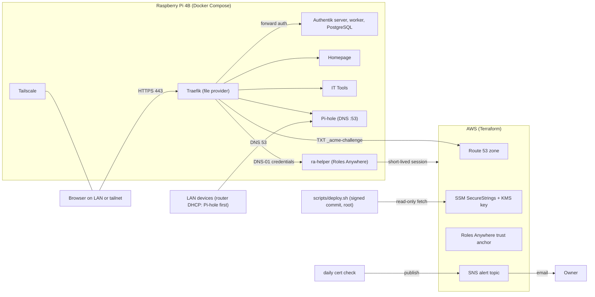

# home-lab

A hardened, reproducible edge layer for a Raspberry Pi 4B home lab, built in the open.

Every service is reachable by name over HTTPS with a real Let's Encrypt wildcard certificate, never by typing a port, and only from the home LAN or over Tailscale.
Everything sits behind single sign-on with MFA. All AWS infrastructure is Terraform, and the Pi only runs commits that carry the owner's signature.

This repository is a reference you can read, copy and adapt. It is a personal project maintained on a best-effort basis.

## What runs today

| Layer | Component |
|-------|-----------|
| Reverse proxy | Traefik v3 on ports 80 and 443 only, non-root. Routes come from the **file provider** (`traefik/dynamic/`); there is no Docker provider and no Docker socket anywhere |
| TLS | Let's Encrypt wildcard certificate for `*.<domain>` by DNS-01 on Route 53. A small helper (`ra-helper`) gives Traefik short-lived AWS credentials through **IAM Roles Anywhere**, so no AWS key is stored on the Pi |
| Identity | **Authentik** SSO with enforced MFA. Traefik does **forward auth** to Authentik for every app; the Traefik dashboard and Homepage both use it. A rate-limited break-glass login exists for the Traefik dashboard only and never survives a reboot |
| Dashboard | **Homepage** at `https://dashboard.<domain>` |
| Apps | **IT Tools** at `https://tools.<domain>` (static, built locally on a current NGINX base). **Pi-hole**: DNS for the LAN on IPv4 port 53 (Quad9 upstream, DNSSEC; the lab names answer the Pi's LAN address), web UI at `https://pihole.<domain>/admin/`. More apps follow one milestone at a time (R17: Linkwarden, Netdata, Portainer, Home Assistant) |
| Remote access | **Tailscale** (no router port-forwards). Services are allowed from the LAN and tailnet ranges only |
| Secrets | AWS **SSM Parameter Store** SecureStrings encrypted with a customer-managed key; only the Pi's role can decrypt. Set by the owner with `scripts/set-secret.sh`, fetched at deploy time into `/apps/secrets`, never in git, CI or Terraform state |
| Deploys | **Signed deploys**: `scripts/deploy.sh` merges and runs only a commit whose SSH signature verifies against a root-owned trust file on the Pi |
| AWS | Route 53 zone, Roles Anywhere identities, KMS key, budget alert and an SNS alert topic, all in Terraform (HCP Terraform with OIDC dynamic credentials and split plan and apply roles) |
| Alerting | A daily check mails you (SNS email) when the certificate Traefik actually serves, or a Pi certificate, is close to expiry or wrong; a monthly test mail proves the path still works |

Routing is by subdomain. The apex and `www` are reserved for a separate future public site and are never served from the Pi.
**Rule: no console or CLI changes to AWS infrastructure.** Every change goes through Terraform.

## Architecture



Request path in words: browser -> Traefik (TLS, wildcard certificate) -> allowlist (LAN and tailnet only) -> Authentik forward auth (MFA) -> the app.
Certificate path: Traefik asks Let's Encrypt, proves the domain by writing one TXT record in Route 53 using a session that Roles Anywhere issued to the Pi's certificate.
Deploy path: the owner signs one release commit, the Pi verifies the signature before merging, fetches secrets with a read-only role, then `docker compose up`.

## Repository layout

| Path | What is in it |
|------|---------------|
| `compose.yaml` | Root Compose project; includes the six stacks below |
| `traefik/`, `authentik/`, `homepage/`, `tailscale/`, `it-tools/`, `pihole/` | One directory per stack (compose file, config, Traefik file-provider routes, Authentik blueprint as code) |
| `config/` | `lab.env` (public, non-secret settings), `secrets-manifest.tsv` (names, paths and modes of secrets, never values), `allowed_signers.example` |
| `terraform/bootstrap/` | Owner-applied stack: OIDC provider, HCP plan and apply roles, the Pi's Roles Anywhere identities, the KMS key, the alert topic. Has offline policy tests |
| `terraform/edge/` | HCP-applied stack: Route 53, records, budget, the non-secret `/home-lab/config/*` parameters |
| `scripts/` | Pi and laptop scripts (`deploy.sh`, `fetch-secrets.sh`, `preflight.sh`, `alert.sh`, `set-secret.sh`, ...), their self-tests (`test-*.sh`), `lib/` helpers, `systemd/` units, `pki/` offline CA tooling |
| `ci/` | Pinned CI tool images (`ci/images/<tool>/Dockerfile`) and `requirements-ci.txt` |
| `docs/plan/` | The approved design (the single source of truth) |
| `docs/runbooks/` | Setup, release, secrets, rotation, alerting, recovery and the M6 go-live runbooks |
| `.github/` | CI workflows and Dependabot configuration |

## How CI works

- Workflow `ci` (job `checks`) runs on pushes to `main` and on pull requests, except changes that only touch `docs/**` or `*.md` (`paths-ignore`). Workflow `secret-scan` (job `secret-scan`) runs on every push and pull request. They have **no cloud or HCP credentials**, and a guard fails the build if any workflow ever asks for an OIDC token, `write-all` or AWS credentials.
- **Pinned tools.** Third-party tool images (gitleaks, tflint, trivy, terraform) come from `ci/images/<tool>/Dockerfile`, pinned by digest, and Python tooling from `ci/requirements-ci.txt`. They live outside `.github/` because Dependabot is refused there. The terraform image is bumped by hand together with `required_version` in the stacks; the others are bumped by Dependabot.
- **Dependabot** (weekly, grouped, with a few days of cooldown) covers GitHub Actions, Terraform providers, Compose and Docker images, pip and pre-commit. Pull requests are merged locally and covered by a signed release commit (see `docs/runbooks/release-and-deploy.md`).
- **Secret scan.** gitleaks runs over the full history and the working tree with the public rules in `.gitleaks.toml`; the rules have their own test (`scripts/test-gitleaks-rules.sh`). A private denylist of your real identifiers is checked locally with `scripts/check-private-denylist.sh` and never leaves your machine.
- **Self-tests** run the shell scripts against mock `aws` and local servers, check Traefik, Authentik, Homepage, IT Tools and Pi-hole configuration (IT Tools and Pi-hole with the real images and the real Traefik routers), run the Terraform IAM and KMS policy tests offline, run shellcheck, yamllint and tflint, and run `trivy config` over the Terraform code. `scripts/scan-images.sh` scans the container images and is run by hand, not in CI.

## Fork guide: what to change

1. **Domain.** Register or delegate a domain to a Route 53 hosted zone. The domain is a Terraform variable (HCP workspace variable `domain` for the edge stack, the gitignored `terraform.tfvars` for bootstrap); it is stored in SSM as `/home-lab/config/domain`. Replace every `example.com` placeholder you want to keep.
2. **Tailnet.** Edit `TAILNET_CIDR` and `LAN_CIDR` in `config/lab.env` and the allowlist in `traefik/dynamic/middlewares.yml`; adapt `tailscale/policy.example.hujson` and create your own auth key (`tag:homelab`).
3. **AWS account.** Create an IAM Identity Center admin, set `owner_role_arn_pattern` and the other variables from `terraform/*/terraform.tfvars.example` in a gitignored `terraform.tfvars`, and follow `docs/runbooks/hcp-terraform-bootstrap.md`. Account IDs, zone IDs and ARNs never go in git.
4. **HCP Terraform.** Create your organisation, project and workspace; set the names in the bootstrap variables. Change the `Repo` and `Owner` tags in `terraform/bootstrap/providers.tf`.
5. **Certificate authority.** The Pi's two Roles Anywhere certificates come from a small **offline** CA you create (`scripts/pki/`, `pki/README.md`). Keep the CA key off the Pi and off the network. For the public certificate, `ACME_ENV` and `ACME_CA_SERVER` in `config/lab.env` select Let's Encrypt staging or production.
6. **Signing key.** Create an SSH signing key, put the public key in `/etc/home-lab/allowed_signers` on the Pi (see `config/allowed_signers.example`), and sign one release commit per deploy.
7. **Alerts.** Set `alert_email` in the bootstrap `terraform.tfvars`, confirm the SNS subscription mail, and run `sudo scripts/alert.sh test` (`docs/runbooks/alerting.md`).
8. **Accounts and secrets.** Create the SecureStrings with `scripts/set-secret.sh --create`, then set them (`docs/runbooks/secrets-ssm.md`). Replace the Authentik blueprint users and groups to match your household.
9. **Pi-hole (optional).** Set the HCP workspace variable `pi_lan_ipv4` to the Pi's reserved LAN address (stored as `/home-lab/config/pi-lan-ip`), pick the upstreams in `PIHOLE_UPSTREAMS` (`config/lab.env`), set `pihole/admin-password`, then point your router's DHCP DNS at the Pi (`docs/runbooks/m8-pihole.md`).
10. **Repository settings.** Follow `docs/runbooks/m6-go-live.md` before making your fork public: private denylist, ruleset, secret scanning, push protection.

## Security model in short

- Reachable only from the LAN and tailnet; no inbound port-forwards; MFA at Authentik for everything.
- No long-lived AWS keys anywhere: the Pi uses Roles Anywhere sessions, CI has no AWS access, HCP uses OIDC with separate plan and apply roles.
- The HCP apply role cannot change any IAM role, trust policy or Roles Anywhere object; the lab roles are owner-applied.
- SecureStrings are encrypted with a customer-managed key whose policy lets only the Pi decrypt; they are not Terraform-managed and never in state.
- Signed deploys, a root-owned checkout, no Docker socket exposure, no Docker group for the login user, containers run non-root with their own service IDs.
- Findings and reporting: [`SECURITY.md`](SECURITY.md). Report vulnerabilities privately through GitHub's private vulnerability reporting.

## Status

| Milestone | Scope | Status |
|-----------|-------|--------|
| M0 | Repository hygiene, CI, gitleaks, Dependabot | Done |
| M1 | HCP Terraform and AWS foundation; Route 53 adopted into Terraform | Done |
| M2 | Pi bootstrap, Tailscale, offline CA, Roles Anywhere identity, signed deploys | Done |
| M3 | Traefik and the Roles Anywhere helper (Let's Encrypt staging) | Done |
| M4 | Authentik SSO with enforced MFA and forward auth | Done |
| M5 | Homepage dashboard | Done |
| M6 | Production certificate, alerting, hardening, repository made public | In progress (`docs/runbooks/m6-go-live.md`) |
| M7 | IT Tools (first R17 app) | Done (`docs/runbooks/m7-it-tools.md`) |
| M8 | Pi-hole for the LAN | In progress (`docs/runbooks/m8-pihole.md`) |

Backups (K5): a nightly age-encrypted `pg_dump` of the Authentik database goes to a write-only, versioned S3 bucket (`docs/runbooks/authentik-backup.md`), and the offline CA has a documented, testable backup (`docs/runbooks/ca-backup.md`). The recovery drill (`docs/runbooks/pi-recovery.md`) is the owner's to run.

Later phases (not scheduled): DNSSEC for the zone, more services behind the same pattern.

## Development

```sh
pip install pre-commit -r ci/requirements-ci.txt
pre-commit install          # gitleaks, yaml, shellcheck hooks on every commit
yamllint --strict .
bash scripts/test-ops-scripts.sh && bash scripts/test-alert.sh   # offline self-tests, no AWS
```

## Licence

[MIT](LICENSE) (c) 2026 Hennie Francis
