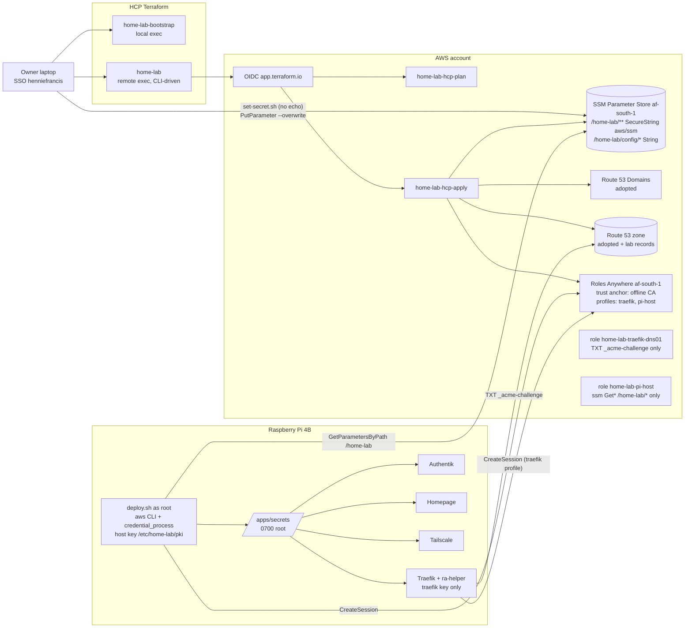

# Phase 1 Build Plan - Edge: Route 53 (adopted into Terraform via HCP Terraform) + SSM secrets + Traefik + Socket Proxy + Authentik SSO + Tailscale + Homepage

Status: APPROVED, ready for build (rev 7). All user questions resolved (section 14).
Owner: Hennie Francis
Author: Solutions Architect (dev-team pipeline)
Date: 2026-11-07

> This plan lives in the new repo as `docs/plan/phase-1-traefik.md` and is self-contained.
> The old working copy (`home-lab-archive`) must never be pushed.
>
> **Working agreements (owner):**
> - The owner reviews **milestone by milestone** and approves each one before the next starts.
> - GitHub Actions is capped at **100 min/month while the repo is private**. Keep CI lean (T2).
> - Developer docs are mirrored to the Obsidian vault **"Hennie Francis"**, folder **"Home Lab"**.
> - **No console or CLI changes to Route 53 / Route 53 Domains.** Every DNS change goes through Terraform (golden rule).
> - **The whole repo, config included, is public.** Nothing secret or account-identifying is committed: no real domain, account ID, ARNs, zone ID, HCP org name, email, or secret values. Runtime secrets live in **AWS SSM Parameter Store**.

Revision history:
- rev 1-2: initial plan; subdomains; Homepage; GitHub archive.
- rev 3: Route 53 + Terraform; Roles Anywhere; apex/`www` reserved; `dashboard.`; wildcard-only cert; per-app forward auth.
- rev 4: Route 53 Domains registrar; AWS preflight; budget; CAA.
- rev 5: HCP Terraform with remote runs, OIDC dynamic credentials and a bootstrap workspace.
- rev 6: Cloudflare migration removed; the existing Route 53 zone, records and registered-domain NS are adopted via `import` blocks; milestones M0-M6.
- rev 7 (2026-11-07):
  - The **whole repo, config included, is public.**
  - **Runtime secrets now live in SSM Parameter Store** (SecureString, standard tier, AWS-managed `aws/ssm` key):
    - the parameters are defined in Terraform with **write-only placeholder values**
    - the owner sets real values through a no-echo script
  - The Pi fetches them at deploy time through a **second Roles Anywhere profile/role (`home-lab-pi-host`)** with its **own key and certificate**.
  - The Pi `.env` and `secrets/` dir in the repo checkout are replaced by:
    - committed `config/lab.env` (public, non-secret)
    - Terraform-managed SSM `String` config parameters
    - fetched secret files under `/apps/secrets` (outside the repo)

---

## 1. Summary

Rebuild the Raspberry Pi 4B home lab as a fresh, **fully public** GitHub repo, starting with a hardened edge layer. The repo shows exactly how the lab is built: Compose files, Traefik and Authentik config, Terraform, scripts and runbooks. Secrets and account-identifying values never enter git.

**AWS side (Terraform, state in HCP Terraform):**
- The domain `example.com` is registered with **Amazon Route 53 Domains**. It is already delegated to a Route 53 public hosted zone that the owner created by hand.
- Phase 1 **adopts** the zone, its existing records and the registered domain's NS into Terraform, **without recreating anything**. It then adds the lab records.
- Terraform also creates:
  - **SSM parameters** under `/home-lab/`:
    - SecureString secrets, whose values the owner sets once (never via Terraform state)
    - String config values, owned by Terraform
  - **Two IAM roles reached via IAM Roles Anywhere**, so there are no long-lived keys anywhere:
    - `home-lab-traefik-dns01`: Traefik's ACME DNS-01; TXT `_acme-challenge` only; no SSM access
    - `home-lab-pi-host`: deploy-time secret fetch; read-only on `/home-lab/*`
  - A USD 5 budget alert.
- HCP Terraform runs authenticate to AWS through **OIDC dynamic credentials**.

**Pi side:**
- **Traefik v3** is the only ingress (80/443), with a **read-only socket proxy**.
- One **Let's Encrypt wildcard `*.${DOMAIN}`** certificate via Route 53 DNS-01.
- **Authentik** SSO + MFA with **per-app forward auth** (host-only cookies).
- **Tailscale** for remote access.
- **Homepage** at `https://dashboard.${DOMAIN}`.
- `scripts/deploy.sh` fetches secrets from SSM into `/apps/secrets` (outside the repo, never echoed), then runs `docker compose up -d`.

**Domain layout:**
- The apex `${DOMAIN}` and `www.${DOMAIN}` are **reserved for a future public website on EC2** (out of scope; never served by the Pi).
- Every other subdomain is home lab: private (LAN `10.0.0.0/24` + tailnet `100.64.0.0/10`) and Authentik-authenticated.
- No port-forwards.

**Hard requirements:** never type a port; everything on Let's Encrypt TLS; start from `dashboard.${DOMAIN}`.

**Phase 1 is done when all of the following hold:**
1. The zone, its records, the registered-domain NS, the SSM parameters and the IAM/Roles Anywhere objects are all managed by Terraform, and a fresh plan shows no changes.
2. No real secret value is in HCP state, git or CI.
3. `https://dashboard.${DOMAIN}` and `https://traefik.${DOMAIN}` serve the production LE wildcard behind Authentik + MFA, from the LAN and over Tailscale only.
4. No apex or `www` record points at the Pi.
5. The repo is public.

**Out of scope:**
- the EC2 website
- Route 53 DNSSEC (Phase 2)
- VCS-triggered Terraform runs
- the `tfe` provider (Phase 2)
- a customer-managed KMS key (Phase 2 option)
- backups (later phase)
- a blog post (the README tells the public story)

## 2. Assumptions and decisions

| # | Item | Status |
|---|------|--------|
| A1 | Raspberry Pi OS 64-bit (arm64 userland), Docker apt repo, Compose >= 2.20 | ASSUMPTION; verified by `scripts/preflight.sh` |
| A2 | Boot device | Preflight WARN; SSD recommended (R5) |
| A3 | Pi IP | U5 DHCP reservation |
| A4 | SSH | Preflight reports it; key-only recommended; Pi Connect is break-glass |
| A5 | Existing Route 53 state | FACT: the zone and registered NS were made by hand. `aws-preflight.sh` inventories them (6.9) |
| A6 | DNSSEC | FACT: off. Phase 2 |
| A7 | Cloudflare | Gone (account deleted); old secrets are moot |
| A8 | HSTS | `includeSubDomains` on lab hosts only; no preload |
| A9 | Licence | MIT |
| A10 | ACME email | **Omitted by default** (Let's Encrypt stopped sending expiry email). If Traefik v3.7 requires one (dev to verify), use SecureString `/home-lab/traefik/acme-email`, set by the owner |
| A11 | Update bot | Dependabot, weekly, grouped |
| A12 | Hostnames | `dashboard.`, `traefik.`, `auth.`, `bg-traefik.`. Future: `ha.`, `tools.`, `links.`, `netdata.`, `pihole.`, `portainer.`. Reserved: apex, `www` |
| A13 | GitHub | `home-lab` stays PRIVATE until the end of M6, then public. **Everything committed is designed to be public from day one** |
| A14 | AWS login | IAM Identity Center profile `henniefrancis`, used only for bootstrap, the read-only preflight and the owner's `set-secret.sh` |
| A15 | af-south-1 / SCPs | Gated by `aws-preflight.sh` |
| A16 | Budget | USD 5/month; email is a sensitive HCP workspace variable |
| A17 | CAA | `letsencrypt.org` (issue, issuewild), `amazon.com` (issue) |
| A18 | Terraform runs | HCP Terraform, remote, CLI-driven; owner approves every apply; no AWS/HCP credentials in CI |
| A19 | HCP org | `TF_CLOUD_ORGANIZATION` / `hcp_organization`; never hard-coded |
| A20 | HCP objects | Project `home-lab`; workspaces `home-lab-bootstrap` (local execution) and `home-lab` (remote, CLI-driven, auto-apply off, destroy plans disabled); created by the owner in the UI |
| A21 | State contents | No secrets: SSM SecureString values are write-only placeholders (6.7.3). The only sensitive datum is the budget email |
| **A22** | **Secret store** | **SSM Parameter Store, SecureString, Standard tier, AWS-managed key `aws/ssm`, region af-south-1.** No customer-managed KMS key: about USD 1/month is 20% of the budget, and IAM path scoping plus Roles Anywhere gives the needed control (R46). GitHub Actions secrets are **not** used for runtime secrets |
| **A23** | **Pi identities** | **Two separate keys and certs**, both signed by the offline CA: `home-lab-pi-traefik` (mounted only into the ra-helper container) and `home-lab-pi-host` (root-only on the host, never mounted into any container). A compromised Traefik container therefore cannot read SSM |
| **A24** | **Secret files on the Pi** | **Persistent** under `/apps/secrets` (root-owned dir 0700, files 0400/0600) rather than tmpfs. Reason: the lab must come back after a power cut even when the internet is down. The host's Roles Anywhere key already lives on disk and can fetch every secret, so tmpfs adds little protection (R41) |

## 3. Architecture

### 3.1 Diagram



### 3.2 Request flow for `https://dashboard.${DOMAIN}`

1. **DNS:** the wildcard `*` record returns the Pi's tailnet IP. `www` is excluded by a TXT placeholder, and there is no apex A record pointing at the Pi. LAN clients without Tailscale use hosts entries until Pi-hole arrives.
2. **Redirect:** `:80` gets a 308 to `:443`.
3. **Middleware chain:** `lan-allowlist@file`, then `security-headers@file`, then `authentik@file`.
4. **Authentication:** unauthenticated users go via `/outpost.goauthentik.io/` to `auth.` (login + MFA) and come back with a host-only cookie.
5. **Routing:** Traefik forwards to Homepage `:3000`.

### 3.3 Secrets flow (new in rev 7)

1. **Terraform** (`edge`) creates each SecureString parameter with the **write-only** argument `value_wo = "UNSET-set-via-set-secret"` and `value_wo_version = 1`. Write-only values are never stored in state. Terraform also creates the String config parameters (domain, zone ID, Roles Anywhere ARNs), whose values it owns.
2. **The owner** runs `scripts/set-secret.sh <parameter-name>` on the laptop with SSO profile `henniefrancis`.
   - It prompts with `read -rs` (no echo).
   - The value travels only through pipes (`jq -Rs` from stdin, then `aws ssm put-parameter --cli-input-json file:///dev/stdin --overwrite`). It is never in argv, shell history or a file in the repo.
   - The **password manager** holds the offline copy of every value.
   - **This is the documented secret-value exception to the Terraform-only rule:** the parameter resource is Terraform-managed; only its value is set out of band.
3. **The Pi** runs `scripts/deploy.sh` as root. It calls `scripts/fetch-secrets.sh`, which:
   - uses the AWS CLI v2 with a `credential_process` profile (`aws_signing_helper credential-process` with the **host** cert and key)
   - runs `GetParametersByPath /home-lab --recursive --with-decryption`
   - maps each parameter to a file using the committed `config/secrets-manifest.tsv` (parameter, target path, owner, mode, required)
   - writes to a staging dir under `/apps/secrets/.staging-XXXX` (umask 077), then renames atomically
   - **fails closed** if any required parameter still holds the `UNSET-` placeholder
   - on any error, cleans the staging dir up and leaves the last-good secrets in place
   - never echoes values (no `set -x`; jq output goes straight to files)
4. **Compose** reads non-secret config from `config/lab.env` (committed) and `${APPS_ROOT}/secrets/runtime.env` (rendered from the `/home-lab/config/*` String parameters). Secrets come in as Compose `secrets:` from `/apps/secrets/<service>/<name>`.

### 3.4 Key decisions and rejected alternatives

| Decision | Chosen | Rejected and why |
|----------|--------|------------------|
| Public repo | All config is committed; secrets and identifiers come from SSM. | A private repo or a private config repo (the owner wants to show the build). |
| Secret store | **SSM Parameter Store SecureString, Standard tier (free), `aws/ssm`.** | **Secrets Manager:** USD 0.40 per secret per month, about 6 secrets is about USD 2.40, half the budget, and rotation features aren't needed. **GitHub Actions secrets:** they would need a self-hosted runner on a public repo, or inbound access to the Pi. **Customer-managed KMS key:** about USD 1/month, which is not justified at this budget. |
| Secret values in Terraform | **`value_wo` placeholder + `value_wo_version`** (write-only, never in state); the owner sets real values out of band. | `value` + `ignore_changes`: the provider docs state that a SecureString `value` is stored in state as plain text, and a refresh would read the real value back in. Real values in tfvars or workspace variables would land in state. |
| Pi to AWS identity for secrets | **Separate Roles Anywhere profile and role `home-lab-pi-host`, with its own key and cert (CN `home-lab-pi-host`)**, root-only on the host. | Reusing the Traefik cert/role: a Traefik compromise would then expose every secret. An IAM user key on the Pi (long-lived). |
| Revocation without a CRL | Both trust policies also pin `aws:PrincipalTag/x509Subject/OU = <pki_generation>` (for example `gen-1`). If a Pi is lost, bump `pki_generation` in Terraform and reissue the certs, and old certs stop working. | CRL import (Phase 2). Replacing the CA (heavier). |
| Secret files on the Pi | Persistent `/apps/secrets` (0700, files 0400/0600), outside the repo checkout; refreshed by every deploy. | tmpfs `/run`: secrets vanish on reboot, and an offline boot would leave every service down. |
| Non-secret config | `config/lab.env` committed (CIDRs, TZ, paths, ACME staging/prod switch); `/home-lab/config/*` SSM String values from Terraform (domain, zone ID, ACME Roles Anywhere ARNs). | A gitignored `.env` (hides the config from the public, and drifts). |
| Existing DNS | Adopt via `import`, no-op first plan, a `check` that the registered NS match the zone. | Recreating. |
| State / runs | HCP Terraform, remote, OIDC, split plan/apply roles, CLI-driven. | S3; static keys; VCS-driven on a public repo. |
| Certificate | One LE `*.${DOMAIN}`. | Apex SAN; per-host certs. |
| Auth | Per-app forward auth, host-only cookies. | A domain cookie. |
| Docker discovery | GET-only socket proxy. | Raw `docker.sock`. |
| Tailscale | Container, host network, `tag:homelab`, auth key from SSM. | Host install; subnet router. |

## 4. Tech stack and pinned versions

| Component | Version | Verified at |
|-----------|---------|-------------|
| Traefik | `traefik:v3.7.17` | GitHub releases ("Latest", 30 Oct 2026) |
| Docker socket proxy | `tecnativa/docker-socket-proxy:v0.5.0` | GitHub / Docker Hub (27 Jul 2026, arm64) |
| Authentik | `ghcr.io/goauthentik/server:2026.8.5` | GitHub releases (21 Oct 2026); official compose default |
| PostgreSQL | `postgres:16.15-alpine3.24` | Docker Hub (26 Oct 2026) |
| Tailscale | `tailscale/tailscale:v1.104.4` | Docker Hub (28 Oct 2026) |
| Homepage | `ghcr.io/gethomepage/homepage:v2.7.0` | GitHub releases (23 Oct 2026) |
| Break-glass holder | `traefik/whoami:v1.12.0` | Docker Hub (29 Jul 2026) |
| Roles Anywhere helper | `aws_signing_helper` 1.8.6 Linux Aarch64, SHA256 `b8a1800a9f483674a376170e1eabc0796a4ad3b7ac048670de9346975e9925dc` | AWS Roles Anywhere user guide (4 Nov 2026). Used in the ra-helper image **and** installed on the Pi host |
| ra-helper base | `debian:trixie-slim` @digest | Debian 13, glibc 2.41 |
| AWS CLI v2 (Pi host) | latest v2 aarch64 from the official installer, GPG-signature verified by `bootstrap.sh`; version recorded | AWS CLI install guide |
| Terraform | 1.17.1 (`~> 1.17`); write-only arguments need >= 1.11 | GitHub releases (28 Oct 2026) |
| AWS provider | 6.71.0 (`~> 6.71`) | GitHub releases (28 Oct 2026) |

**Official sources (rev 7 additions):**
- **`aws_ssm_parameter`:** https://registry.terraform.io/providers/hashicorp/aws/latest/docs/resources/ssm_parameter
  - "The unencrypted value of a SecureString will be stored in the raw state as plain-text"
  - `value_wo` "write-only values are never stored to state", Terraform >= 1.11
  - `value_wo_version` must change to push a new write-only value
- **Roles Anywhere credential helper:** `credential-process` and `serve`: https://docs.aws.amazon.com/rolesanywhere/latest/userguide/credential-helper.html
- **Roles Anywhere trust model** (PrincipalTag `x509Subject/*` conditions): https://docs.aws.amazon.com/rolesanywhere/latest/userguide/trust-model.html

**Sources carried over from rev 6:** HCP dynamic credentials, Route 53 IAM conditions and wildcard behaviour, `route53domains_registered_domain`, lego route53, Authentik, Homepage, Compose include, Tailscale.

## 5. Repo layout (public)

```
home-lab/
  README.md  LICENSE (MIT)  SECURITY.md
  .gitignore            # defensive: .env*, secrets/, *.tfvars, *.auto.tfvars (keep *.example), *.tfstate*, **/.terraform/,
                        # *.pem, *.key, *.csr, *.crt (except pki/*.cnf), adopt-snapshot/, crash.log
  .gitattributes  .editorconfig  .pre-commit-config.yaml  .yamllint.yaml  .tflint.hcl
  compose.yaml          # include: traefik, authentik, tailscale, homepage
  config/
    lab.env             # PUBLIC non-secret config (committed)
    secrets-manifest.tsv  # parameter -> file path, owner, mode, required (no values)
  .github/dependabot.yml  .github/workflows/ci.yml
  terraform/
    bootstrap/  versions.tf providers.tf oidc.tf roles.tf variables.tf outputs.tf terraform.tfvars.example
    edge/       versions.tf providers.tf variables.tf route53.tf records.tf domains.tf imports.tf checks.tf
                iam-dns01.tf iam-pi-host.tf rolesanywhere.tf ssm.tf budget.tf outputs.tf workspace-variables.example.md
  pki/  README.md openssl-ca.cnf openssl-leaf.cnf
  scripts/
    aws-preflight.sh   # laptop, read-only gate before applies
    set-secret.sh      # laptop, owner-run, no-echo PutParameter --overwrite
    preflight.sh  bootstrap.sh  deploy.sh  fetch-secrets.sh  cert-expiry.sh      # Pi
    pki-new-ca.sh  pki-sign.sh  pki-pi-csr.sh
  traefik/  compose.yaml  ra-helper/Dockerfile  dynamic/middlewares.yml  dynamic/tls.yml
  authentik/ compose.yaml  blueprints/homelab-apps.yaml
  homepage/  compose.yaml  config/{settings,services,bookmarks,widgets,docker}.yaml custom.css custom.js
  tailscale/ compose.yaml  policy.example.hujson
  docs/plan/phase-1-traefik.md
  docs/runbooks/ first-deploy.md hcp-terraform-bootstrap.md adopt-existing-route53.md secrets-ssm.md
                 rolesanywhere-pki.md cert-staging-to-prod.md break-glass.md rotate-secrets.md pi-recovery.md add-a-service.md
```

`config/lab.env` (committed, public):

```dotenv
LAN_CIDR=10.0.0.0/24
TAILNET_CIDR=100.64.0.0/10
TZ=Africa/Johannesburg
APPS_ROOT=/apps
PROXY_SUBNET=172.30.0.0/24
TS_HOSTNAME=homelab-pi
PUID=1000
PGID=1000
AWS_SSM_REGION=af-south-1
ACME_ENV=staging
ACME_CA_SERVER=https://acme-staging-v02.api.letsencrypt.org/directory
# prod (M6, via PR): ACME_ENV=prod / ACME_CA_SERVER=https://acme-v02.api.letsencrypt.org/directory
```

`${APPS_ROOT}/secrets/runtime.env` (rendered by `fetch-secrets.sh` from `/home-lab/config/*`, mode 0600, never committed):

```dotenv
DOMAIN=...
ROUTE53_ZONE_ID=...
RA_TRUST_ANCHOR_ARN=...
RA_ACME_PROFILE_ARN=...
RA_ACME_ROLE_ARN=...
```

**Compose invocation** (in `deploy.sh`): `docker compose --env-file config/lab.env --env-file "${APPS_ROOT}/secrets/runtime.env" up -d --remove-orphans`. Later files override earlier ones. The dev must verify that `include:` children interpolate from these project-level env files.

**Pi-local bootstrap file** `/etc/home-lab/aws.env` (root 0600). It is created once by the owner from Terraform outputs and is not secret, but it is account-identifying:

```
AWS_REGION=af-south-1
RA_TRUST_ANCHOR_ARN=...
RA_HOST_PROFILE_ARN=...
RA_HOST_ROLE_ARN=...
```

`fetch-secrets.sh` writes `/etc/home-lab/aws-config` (root 0600), a `credential_process` profile pointing to `/usr/local/bin/aws_signing_helper credential-process --certificate /etc/home-lab/pki/host.crt --private-key /etc/home-lab/pki/host.key ...`, and sets `AWS_CONFIG_FILE` for its own process only.

### 5.1 SSM parameter hierarchy

| Parameter | Type | Set by | Consumer | File on the Pi (owner:mode) | Required |
|-----------|------|--------|----------|-----------------------------|----------|
| `/home-lab/authentik/secret-key` | SecureString | owner (set-secret) | Authentik `file://` | `/apps/secrets/authentik/secret-key` (1000:1000 0400) | yes |
| `/home-lab/authentik/postgres-password` | SecureString | owner | Postgres `POSTGRES_PASSWORD_FILE`, Authentik `file://` | `/apps/secrets/authentik/postgres-password` (1000:1000 0400; dev to verify the Postgres read path) | yes |
| `/home-lab/authentik/bootstrap-password` | SecureString | owner | Authentik `AUTHENTIK_BOOTSTRAP_PASSWORD` for `akadmin` on **first start only**. This closes the initial-setup window. Dev to verify it can be file-sourced; otherwise use the initial-setup flow and leave the parameter UNSET | `/apps/secrets/authentik/bootstrap-password` (1000:1000 0400) | no |
| `/home-lab/traefik/breakglass-htpasswd` | SecureString | owner (bcrypt line from `htpasswd -nB`; the plaintext stays in the password manager) | Traefik basicAuth `usersFile` | `/apps/secrets/traefik/breakglass-htpasswd` (root 0400) | yes |
| `/home-lab/tailscale/auth-key` | SecureString | owner (one-off, `tag:homelab`, 1-day key) | written as `TS_AUTHKEY=...` | `/apps/secrets/tailscale/tailscale.env` (root 0600) | **once**: if UNSET, write an empty file (`TS_AUTH_ONCE=true` keeps the node joined) |
| `/home-lab/homepage/authentik-token` | SecureString | owner (optional read-only Authentik API token) | `HOMEPAGE_FILE_AUTHENTIK_TOKEN` | `/apps/secrets/homepage/authentik-token` (1000:1000 0400) | no |
| `/home-lab/traefik/acme-email` | SecureString | owner, only if needed (A10) | Traefik `acme.email` (via `runtime.env`) | - | no |
| `/home-lab/config/domain` | String | Terraform (`var.domain`) | `runtime.env` | - | yes |
| `/home-lab/config/route53-zone-id` | String | Terraform | `runtime.env` | - | yes |
| `/home-lab/config/ra-trust-anchor-arn`, `ra-acme-profile-arn`, `ra-acme-role-arn` | String | Terraform | `runtime.env` (ra-helper) | - | yes |

**Rules:**
- The manifest (`config/secrets-manifest.tsv`) is the single mapping and is public.
- Adding a service means adding a parameter in `ssm.tf`, adding a manifest row, then running `set-secret.sh`.
- The **ACME (Traefik) Roles Anywhere key and cert are not in SSM.** They are generated on the Pi under `/etc/home-lab/pki/` (traefik key `10001:10001 0400`). The host key (`root 0400`) is never mounted into any container.

## 6. Specifications

### 6.1 Docker networks

| Network | Flags | Members |
|---------|-------|---------|
| `proxy` | bridge, `--subnet ${PROXY_SUBNET}` | traefik (+ ra-helper via shared netns), authentik-server, homepage |
| `socket-proxy` | `--internal` | traefik, homepage, socket-proxy |
| `authentik-internal` | `--internal` | authentik server, worker, postgres |

Every service uses json-file logging with 10m x 3 rotation.

### 6.2 Traefik + ra-helper + socket proxy + break-glass (`traefik/compose.yaml`)

**traefik**
- Hardening: `restart: unless-stopped`, `read_only`, `no-new-privileges`, `cap_drop ALL` + `NET_BIND_SERVICE`, memory 256M, healthcheck `traefik healthcheck --ping`.
- Ports: 80/443 only.
- Mounts: `./dynamic:/etc/traefik/dynamic:ro`, `${APPS_ROOT}/traefik/letsencrypt:/letsencrypt`, `${APPS_ROOT}/traefik/logs:/logs`.
- Secret: `breakglass_users` from `file: ${APPS_ROOT}/secrets/traefik/breakglass-htpasswd`.
- Environment: `AWS_REGION=us-east-1`, `AWS_HOSTED_ZONE_ID=${ROUTE53_ZONE_ID}`, `AWS_EC2_METADATA_SERVICE_ENDPOINT=http://127.0.0.1:9911`. No static keys; `AWS_EC2_METADATA_DISABLED` unset.
- Static config (`command:`). Validate every flag against the v3.7 docs.

```
--global.checkNewVersion=false
--global.sendAnonymousUsage=false
--log.level=INFO --log.format=json
--accesslog=true --accesslog.format=json --accesslog.filepath=/logs/access.log
--ping=true --api.dashboard=true --api.insecure=false
--providers.docker.endpoint=tcp://socket-proxy:2375
--providers.docker.exposedByDefault=false
--providers.docker.network=proxy
--providers.file.directory=/etc/traefik/dynamic --providers.file.watch=true
--entrypoints.web.address=:80
--entrypoints.web.http.redirections.entrypoint.to=websecure
--entrypoints.web.http.redirections.entrypoint.scheme=https
--entrypoints.web.http.redirections.entrypoint.permanent=true
--entrypoints.websecure.address=:443
--entrypoints.websecure.asDefault=true
--entrypoints.websecure.http.tls.certResolver=le
--entrypoints.websecure.http.tls.options=modern@file
--entrypoints.websecure.http.tls.domains[0].main=*.${DOMAIN}
--entrypoints.websecure.http.middlewares=security-headers@file
--certificatesresolvers.le.acme.caServer=${ACME_CA_SERVER}
--certificatesresolvers.le.acme.storage=/letsencrypt/acme-${ACME_ENV}.json
--certificatesresolvers.le.acme.dnsChallenge.provider=route53
--certificatesresolvers.le.acme.dnsChallenge.resolvers=1.1.1.1:53,8.8.8.8:53
```

**Router labels:**
- `dashboard`: `Host(traefik.${DOMAIN})`, `api@internal`, middlewares `lan-allowlist@file,authentik@file`.
- `dashboard-outpost`: `Host(traefik.${DOMAIN}) && PathPrefix(/outpost.goauthentik.io/)`, service `authentik`, `lan-allowlist@file`, priority 100.
- Middleware `breakglass-auth`: basicauth usersfile `/run/secrets/breakglass_users`.
- During M3 the dashboard uses `lan-allowlist@file,breakglass-auth@docker`.

**ra-helper**
- `home-lab/ra-helper:1.8.6`, built from `debian:trixie-slim@digest` + `ca-certificates` + `ADD --checksum=sha256:b8a1800a...` of the official binary; `USER 10001`.
- `network_mode: service:traefik`.
- `command: serve --certificate /run/secrets/ra_acme_crt --private-key /run/secrets/ra_acme_key --trust-anchor-arn ${RA_TRUST_ANCHOR_ARN} --profile-arn ${RA_ACME_PROFILE_ARN} --role-arn ${RA_ACME_ROLE_ARN} --session-duration 3600 --port 9911 --hop-limit 1`
- Secrets come from `/etc/home-lab/pki/traefik.crt` and `traefik.key`. **The traefik key only, never the host key.**
- Hardening: `read_only`, `cap_drop ALL`, `no-new-privileges`, 64M, `depends_on: [traefik]`.
- If Traefik is recreated, recreate the helper too (`deploy.sh` always runs `up -d`).

**socket-proxy**
- `tecnativa/docker-socket-proxy:v0.5.0` with `CONTAINERS=1 EVENTS=1 VERSION=1 PING=1 POST=0`.
- Socket mounted `:ro`; `socket-proxy` network only; no ports; 64M; `no-new-privileges`.

**breakglass** (profile)
- `traefik/whoami:v1.12.0`, router `bg-traefik` -> `api@internal`, `lan-allowlist@file,breakglass-auth@docker`.

### 6.3 Traefik dynamic config

`middlewares.yml`:
- `lan-allowlist`: `ipAllowList.sourceRange` = `10.0.0.0/24`, `100.64.0.0/10`. `preflight.sh` checks this against `config/lab.env`.
- `security-headers`: `stsSeconds` 300 (raised to 31536000 at M6), `stsIncludeSubdomains`, no preload, `forceSTSHeader`, `contentTypeNosniff`, `frameDeny`, `referrerPolicy strict-origin-when-cross-origin`, `permissionsPolicy "camera=(), microphone=(), geolocation=(), payment=()"`, `X-Robots-Tag noindex, nofollow`, `Server ""`.
- `authentik`: forwardAuth to `http://authentik-server:9000/outpost.goauthentik.io/auth/traefik`, `trustForwardHeader: true`, `maxResponseBodySize: 4194304`, and `authResponseHeaders`: X-authentik-username, groups, entitlements, email, name, uid, jwt, meta-jwks, meta-outpost, meta-provider, meta-app, meta-version.

`tls.yml`: option `modern` with `minVersion: VersionTLS12` and `sniStrict: true`.

### 6.4 Authentik (`authentik/compose.yaml`)

Based on the official 2026.8.5 compose (no Redis), with no published ports, no `docker.sock`, internal networks and memory limits.

**authentik-postgresql**
- `postgres:16.15-alpine3.24`
- `POSTGRES_DB=authentik`, `POSTGRES_USER=authentik`, `POSTGRES_PASSWORD_FILE=/run/secrets/pg_password` (from `${APPS_ROOT}/secrets/authentik/postgres-password`)
- Volume `${APPS_ROOT}/authentik/postgres`; healthcheck `pg_isready`; 512M

**authentik-server**
- `command: server`; `proxy` + `authentik-internal`; 1G
- Environment:
  - `AUTHENTIK_POSTGRESQL__HOST=authentik-postgresql`, `__NAME=authentik`, `__USER=authentik`
  - `AUTHENTIK_POSTGRESQL__PASSWORD=file:///run/secrets/pg_password`
  - `AUTHENTIK_SECRET_KEY=file:///run/secrets/authentik_secret_key`
  - `AUTHENTIK_LISTEN__TRUSTED_PROXY_CIDRS=${PROXY_SUBNET}`
  - `AUTHENTIK_ERROR_REPORTING__ENABLED=false`
  - `DOMAIN=${DOMAIN}`
  - `AUTHENTIK_COOKIE_DOMAIN` **unset**
  - Optional bootstrap password (5.1)
- Mounts: `/data`, `/templates`, `./blueprints:/blueprints/custom:ro`
- Labels: `Host(auth.${DOMAIN})`, `lan-allowlist@file`, port 9000

**authentik-worker**
- `command: worker`; same environment and secrets; no `docker.sock`

**Blueprint**
- `forward_single` providers + applications for `dashboard` (Homepage) and `traefik`
- embedded outpost
- group `homelab-admins`

**First-run (U10)**
- MFA enforced; `akadmin` deactivated or protected; recovery key tested.
- If the bootstrap password was used, set the parameter back to UNSET afterwards.

### 6.5 Tailscale (`tailscale/compose.yaml`)

- `tailscale/tailscale:v1.104.4`, host network, `/dev/net/tun`, `NET_ADMIN`.
- Environment: `TS_STATE_DIR=/var/lib/tailscale`, `TS_USERSPACE=false`, `TS_AUTH_ONCE=true`, `TS_ACCEPT_DNS=false`, `TS_EXTRA_ARGS=--advertise-tags=tag:homelab`, `TS_HOSTNAME`.
- `env_file: ${APPS_ROOT}/secrets/tailscale/tailscale.env`.
- State in `${APPS_ROOT}/tailscale/state`.
- After the node joins, the owner sets `/home-lab/tailscale/auth-key` back to UNSET (`set-secret.sh --unset`).

### 6.6 Homepage (`homepage/compose.yaml`)

- `ghcr.io/gethomepage/homepage:v2.7.0`, `proxy` + `socket-proxy`, no ports.
- `HOMEPAGE_ALLOWED_HOSTS=dashboard.${DOMAIN}`, `HOMEPAGE_VAR_DOMAIN=${DOMAIN}`.
- Optional `HOMEPAGE_FILE_AUTHENTIK_TOKEN`.
- Routers `homepage` (`lan-allowlist@file,authentik@file`) and `homepage-outpost`.
- Config committed; tiles use `{{HOMEPAGE_VAR_DOMAIN}}`.
- Live tiles: Traefik and Authentik. Placeholders: Home Assistant, IT Tools, Linkwarden, Netdata, Pi-hole, Portainer.

### 6.7 Terraform

**Conventions:**
- All AWS resources via Terraform; hyphens only, no em dashes.
- `default_tags`.
- No identifiers in git; lock files committed.
- `prevent_destroy` on the OIDC provider, run roles, primary zone, registered domain, and the SSM SecureString parameters.
- **The developer loads the `aws-iam` and `aws-secrets-manager` skills before IAM, OIDC, Roles Anywhere or SSM work, and never prints secret values.**

#### 6.7.1 `terraform/bootstrap` (local execution, SSO)

- **OIDC provider** `app.terraform.io` (audience `aws.workload.identity`).
- **Plan and apply roles:** trust uses exact `aud` and `sub` per phase (`organization:<org>:project:home-lab:workspace:home-lab:run_phase:plan|apply`); 1-hour sessions; `prevent_destroy`.
- **Plan role** (read-only):
  - Route 53, Route 53 Domains, Roles Anywhere, IAM and budget reads, as in rev 6
  - `ssm:DescribeParameters`, `ssm:GetParameter(s)`, `ssm:ListTagsForResource` on `parameter/home-lab/*`
  - `kms:Decrypt` on the `aws/ssm` key, only with `kms:ViaService = ssm.af-south-1.amazonaws.com`, **only if** the provider reads with decryption during refresh (dev to verify; if it doesn't, omit it, R47)
- **Apply role:** rev 6 statements (Route 53, Route 53 Domains with its Deny list, Roles Anywhere in af-south-1, budget), plus:

| Statement | Actions | Resource / conditions |
|-----------|---------|-----------------------|
| SsmHomeLab | `ssm:PutParameter`, `DeleteParameter`, `GetParameter`, `GetParameters`, `AddTagsToResource`, `RemoveTagsFromResource`, `ListTagsForResource` | `arn:aws:ssm:af-south-1:<acct>:parameter/home-lab/*` |
| SsmDescribe | `ssm:DescribeParameters` | `*` |
| KmsViaSsm | `kms:Encrypt`, `kms:Decrypt`, `kms:GenerateDataKey` | `aws/ssm` key ARN; `kms:ViaService = ssm.af-south-1.amazonaws.com` |
| LabRolesOnly | IAM role CRUD as rev 6 (`CreateRole`, `UpdateRole`, `UpdateAssumeRolePolicy`, `PutRolePolicy`, `DeleteRolePolicy`, `TagRole`, `UntagRole`, `DeleteRole`) | `role/home-lab-traefik-dns01` **and** `role/home-lab-pi-host` only |
| PassLabRoles | `iam:PassRole` | the same 2 ARNs; `iam:PassedToService = rolesanywhere.amazonaws.com` |

- Still no IAM on `home-lab-hcp-*` or the OIDC provider.
- No users or access keys.
- No `ssm:*` outside `/home-lab/`.

#### 6.7.2 `terraform/edge` (remote, dynamic credentials)

- **Providers:** default af-south-1 plus alias `us_east_1`, both via `tfc_aws_dynamic_credentials` (dev to verify alias reuse).
- **Workspace variables (HCP):** as rev 6, plus `pki_generation` (default `gen-1`).
  - The full set: `TFC_AWS_PROVIDER_AUTH`, `TFC_AWS_PLAN_ROLE_ARN`, `TFC_AWS_APPLY_ROLE_ARN`, `domain`, `existing_zone_id`, `existing_zone_comment`, `registered_name_servers`, `domain_auto_renew`, `domain_transfer_lock`, `existing_records`, `duplicate_zone_ids`, `pi_tailnet_ipv4`, `ca_cert_pem`, `budget_usd`, `budget_email` (sensitive), `pki_generation`.
  - No tfvars files for `edge`.
- **Adoption** (unchanged from rev 6):
  - `imports.tf`: zone, `existing_records` (`for_each`), registered domain, duplicate zones.
  - `checks.tf`: registered NS == zone NS.
  - `records.tf`: wildcard (gated on `pi_tailnet_ipv4`), `www` TXT placeholder, CAA, collision rule.
  - `domains.tf`: adopted registered domain, NS copied exactly, `prevent_destroy`, `aws_route53domains_domain` banned.
  - The adoption plan must be a no-op (11.2).

**`iam-dns01.tf`** (`home-lab-traefik-dns01`):
- Trust: `rolesanywhere.amazonaws.com`; actions `sts:AssumeRole`, `sts:TagSession`, `sts:SetSourceIdentity`. Conditions:
  - `aws:SourceArn` = the trust anchor
  - `x509Subject/CN = home-lab-pi-traefik`
  - `x509Subject/OU = var.pki_generation`
  - `x509Issuer/CN = home-lab-offline-ca`
- Policy:
  - `route53:GetChange` on `change/*`
  - `route53:ListResourceRecordSets` on the zone
  - `route53:ChangeResourceRecordSets` on the zone, with `ForAllValues:StringEquals`: `NormalizedRecordNames ["_acme-challenge.<domain>"]`, `RecordTypes ["TXT"]`, `Actions ["UPSERT","DELETE"]`
- **No SSM or KMS.** 1-hour sessions.

**`iam-pi-host.tf`** (new, `home-lab-pi-host`):
- Trust: same shape as the ACME role, but `x509Subject/CN = home-lab-pi-host` (+ OU generation, issuer CN, SourceArn).
- Policy:

```json
{
  "Version": "2012-10-17",
  "Statement": [
    { "Sid": "ReadHomeLabParams", "Effect": "Allow",
      "Action": ["ssm:GetParameter", "ssm:GetParameters", "ssm:GetParametersByPath"],
      "Resource": ["arn:aws:ssm:af-south-1:<acct>:parameter/home-lab",
                   "arn:aws:ssm:af-south-1:<acct>:parameter/home-lab/*"] },
    { "Sid": "DecryptViaSsmOnly", "Effect": "Allow",
      "Action": "kms:Decrypt",
      "Resource": "<aws/ssm key ARN via data.aws_kms_alias>",
      "Condition": { "StringEquals": { "kms:ViaService": "ssm.af-south-1.amazonaws.com" } } }
  ]
}
```

- No `ssm:PutParameter`, `DeleteParameter` or `DescribeParameters`; no Route 53. 1-hour sessions.
- Dev to verify the exact resource ARN needed for `GetParametersByPath` on the path root.

**`rolesanywhere.tf`:**
- Trust anchor `home-lab-offline-ca` (from `ca_cert_pem`).
- Profiles:
  - `home-lab-traefik` -> `home-lab-traefik-dns01`
  - `home-lab-pi-host` -> `home-lab-pi-host`
  - both with `duration_seconds = 3600`
- Revocation:
  - disable a profile, or
  - bump `pki_generation` and reissue the certs

#### 6.7.3 `ssm.tf` (new)

```hcl
locals {
  secure_params = {
    "authentik/secret-key"         = "Authentik secret key"
    "authentik/postgres-password"  = "Authentik PostgreSQL password"
    "authentik/bootstrap-password" = "Authentik akadmin bootstrap password - first start only"
    "traefik/breakglass-htpasswd"  = "Traefik break-glass basic auth htpasswd line"
    "tailscale/auth-key"           = "Tailscale one-off auth key - UNSET after join"
    "homepage/authentik-token"     = "Homepage Authentik widget API token - optional"
  }
}
resource "aws_ssm_parameter" "secret" {
  for_each         = local.secure_params
  name             = "/home-lab/${each.key}"
  description      = each.value                 # hyphens only, no em dashes
  type             = "SecureString"
  tier             = "Standard"
  # key_id omitted -> AWS managed key alias/aws/ssm
  value_wo         = "UNSET-set-via-set-secret"
  value_wo_version = 1                          # NEVER bump: it would overwrite real values with the placeholder (CI guard)
  lifecycle { prevent_destroy = true }
}
resource "aws_ssm_parameter" "config" {
  for_each       = {
    "config/domain"              = var.domain
    "config/route53-zone-id"     = aws_route53_zone.primary.zone_id
    "config/ra-trust-anchor-arn" = aws_rolesanywhere_trust_anchor.this.arn
    "config/ra-acme-profile-arn" = aws_rolesanywhere_profile.traefik.arn
    "config/ra-acme-role-arn"    = aws_iam_role.dns01.arn
  }
  name           = "/home-lab/${each.key}"
  type           = "String"
  tier           = "Standard"
  insecure_value = each.value                   # non-secret, Terraform-owned
}
```

**Critical verification (T5, before the owner sets any real value):**
1. Apply.
2. Owner sets a dummy value on one parameter (`set-secret.sh`).
3. Run a remote **refresh-only plan**.
4. Inspect the state: the SecureString `value` must be empty or absent and `has_value_wo` must be true. Report match counts only.

If the provider **does** read the decrypted value into state, stop and switch to the fallback: the owner-run `set-secret.sh --create` creates the SecureString parameters, Terraform manages only IAM/KMS and the String parameters, and this is documented as a broader exception. Record the result in the runbook.

**Outputs:** zone, NS, trust anchor, both profile ARNs, both role ARNs. They are not sensitive, but `/etc/home-lab/aws.env` is filled from them and never committed.

#### 6.7.4 Budget

`home-lab-monthly`, USD 5, alerts at 80% actual and 100% forecast to `var.budget_email`.

**Cost:**
- About USD 0.50 per hosted zone.
- SSM Standard parameters and standard-throughput API calls cost nothing.
- `aws/ssm` has no monthly fee; KMS request charges are negligible at this volume.
- Roles Anywhere is free; HCP is on the free tier.
- **Total about USD 0.50-1/month.**

### 6.8 PKI (Roles Anywhere)

1. **CA:** offline ECDSA P-384, CN `home-lab-offline-ca`, 5 years, created on the laptop outside the repo. `ca.key` goes into the password manager.
2. **On the Pi**, `pki-pi-csr.sh` generates **two** P-256 keys and CSRs under `/etc/home-lab/pki/`:
   - `traefik.key` (10001:10001 0400), Subject `CN=home-lab-pi-traefik, OU=<pki_generation>`
   - `host.key` (root:root 0400), Subject `CN=home-lab-pi-host, OU=<pki_generation>`
3. **On the laptop**, `pki-sign.sh` signs both: `CA:false`, `digitalSignature`, `clientAuth`, SHA-256, 365 days. Copy the certs back.
4. Renew yearly. `cert-expiry.sh` and preflight WARN at less than 30 days.
5. No script echoes key material.

### 6.9 Laptop scripts

**`aws-preflight.sh`** (read-only; rev 6 checks plus):
- `aws ssm describe-parameters --region af-south-1 --parameter-filters Key=Path,Option=Recursive,Values=/home-lab` succeeds. It lists existing `/home-lab/*` names only, never values; any that exist must be imported.
- The `aws/ssm` alias exists (`aws kms describe-key --key-id alias/aws/ssm`). It is created on first use, so a WARN is fine.
- The rev 6 checks:
  - tooling, HCP, identity
  - af-south-1 and Roles Anywhere reachability
  - registration details
  - hosted-zone inventory with the DELEGATED/DUPLICATE detection and the HCL `existing_records` output
  - DS sanity
  - existing IAM objects (now also `home-lab-pi-host`)
  - permission simulation

**`set-secret.sh`** (owner, laptop, SSO):
- **Usage:** `set-secret.sh <name>` (for example `authentik/secret-key`), `--unset`, or `--create` (fallback mode only).
- **Before writing:**
  - refuses names outside `/home-lab/` and `config/*`
  - checks that the parameter exists and is a SecureString
  - checks `aws sts get-caller-identity`
- **Input:** prompts twice with `read -rs`; compares; refuses empty values.
- **Writing:** pipes `printf '%s' "$v" | jq -Rs --arg n "/home-lab/$name" '{Name:$n, Value:., Type:"SecureString", Overwrite:true}' | aws ssm put-parameter --cli-input-json file:///dev/stdin --region af-south-1`, then `unset v`.
  - The parameter name is in jq argv; the value is not.
- **Output:** prints the new parameter version only.
- **Platform:** on Windows it runs in Git Bash or WSL. The dev verifies `file:///dev/stdin` works there; otherwise use a `mktemp` file in a 0700 temp dir, removed by `trap`.
- **Hygiene:** never in shell history, never in the repo, never pasted into chats or agents.

### 6.10 Pi scripts

**`bootstrap.sh`** (root, idempotent):
- Creates `/apps/{traefik,authentik,homepage,tailscale}`, `/apps/secrets` (0700 root) and `/etc/home-lab/pki` (0700 root).
- Creates the Docker networks and loads `tun`.
- Installs AWS CLI v2 (aarch64 official installer, signature verified).
- Installs `aws_signing_helper` 1.8.6 aarch64 to `/usr/local/bin` (SHA256 verified, 0555).
- Refuses to run if `preflight.sh` FAILs.

**`fetch-secrets.sh`** (root; called by `deploy.sh`):
- `set -euo pipefail`; `umask 077`; never `set -x`.
- `trap` removes staging on any exit.
- Sources `/etc/home-lab/aws.env`, builds `/etc/home-lab/aws-config` (`credential_process`), and runs `aws ssm get-parameters-by-path --path /home-lab --recursive --with-decryption --output json` piped straight into jq.
- For each manifest row, writes the value into the staging file; validates (placeholder check, required check); chowns and chmods; then renames the staging dir into `/apps/secrets` atomically.
- Renders `runtime.env` from `/home-lab/config/*`.
- On AWS failure (offline): exit non-zero and keep the existing secrets. `deploy.sh` may continue with the last-good secrets only with `--offline` (explicit flag).

**`deploy.sh`:** `git pull --ff-only`, then `fetch-secrets.sh`, then `docker compose --env-file config/lab.env --env-file /apps/secrets/runtime.env pull && up -d --remove-orphans`, then health summary and `cert-expiry.sh`. It never writes inside the repo checkout except via git.

**`preflight.sh`** (rev 6 checks plus):
- `/etc/home-lab/aws.env` is present.
- PKI files: correct owners and modes; certs valid for more than 30 days; subject OU matches `pki_generation` (read from `aws.env`).
- `aws_signing_helper` and AWS CLI are present at their pinned versions.
- `/apps/secrets` is 0700 root.
- **No secret files inside the repo checkout** (`git status --ignored` shows none).

## 7. Well-Architected lens

- **Operational excellence:**
  - The fully public repo is the documentation.
  - Everything in Terraform, apart from the documented secret-value exception.
  - One deploy command fetches secrets and starts services.
  - Pi recovery is reproducible (`pi-recovery.md`).
  - Milestone reviews.
- **Security:**
  - No long-lived keys anywhere: HCP uses OIDC; the Pi uses two Roles Anywhere identities with separate keys and least-privilege roles; the owner uses SSO.
  - Secrets: SecureString encrypted with KMS, never in state, git, CI or the repo checkout; fetched read-only and path-scoped; decrypt only via SSM.
  - A Traefik compromise can't read secrets; a Pi compromise can be revoked by bumping `pki_generation`.
  - Plus the LAN/tailnet allowlist, MFA, host-only cookies and the GET-only socket proxy.
- **Reliability:**
  - Persisted last-good secrets survive offline boots.
  - Atomic secret refresh; fail-closed on placeholders.
  - Adoption no-op gates and `prevent_destroy`.
  - Break-glass and Pi Connect.
- **Performance:** unchanged; the fetch is one API call per deploy.
- **Cost:** about USD 0.50-1/month (SSM Standard free, `aws/ssm` free, no Secrets Manager, no CMK); USD 5 alert.
- **Sustainability:** one ARM host, managed services.

## 8. Phased delivery plan (owner review at the end of EVERY milestone)

| Milestone | Depends on | Acceptance |
|-----------|-----------|------------|
| **M0 - Repo reset** | - | Done: PRIVATE repo, clean history, CI green. Rev 7 adds a public-readiness rule: every committed file is fit to be public now. |
| **M1 - HCP + AWS foundation + adopt DNS + SSM + identities** | M0, U9 | 1. HCP objects exist. 2. `aws-preflight.sh` passes. 3. Bootstrap applied (OIDC + plan/apply roles **with the rev 7 SSM/KMS/pi-host additions**). 4. Workspace variables set. 5. Adoption apply is a no-op (imports only + tags; the `check` passes). 6. Follow-up applies: `www` placeholder, CAA, ACME role, **pi-host role**, Roles Anywhere trust anchor + **both profiles** (once `ca_cert_pem` exists), **SSM SecureString parameters (placeholders) and config String parameters**, budget; inventory decisions; duplicate-zone removal. 7. **The write-only verification (6.7.3) passes.** 8. The owner sets the real values with `set-secret.sh` (U12); a refresh-only plan shows No changes and the state has no values. 9. A fresh plan shows No changes. 10. CloudTrail shows writes only by `home-lab-hcp-apply`, and SSM writes only by the owner's SSO session. 11. tflint, trivy and Access Analyzer are clean. |
| **M2 - Pi preflight, bootstrap, PKI, first secret fetch, Tailscale, wildcard** | M1 (identities + parameters) | 1. `preflight.sh` passes. 2. `bootstrap.sh` installs AWS CLI + helper (checksums verified). 3. **Two** Pi certs issued and installed. 4. `/etc/home-lab/aws.env` written. 5. **`fetch-secrets.sh` succeeds**: correct files, owners and modes; no output values; placeholder detection tested. 6. Tailscale joins using the SSM key, which is then UNSET. 7. `pi_tailnet_ipv4` applied, so the wildcard exists. 8. Negative tests S17 pass. |
| **M3 - Traefik + ra-helper (STAGING)** | M1, M2 | Staging wildcard via Route 53 with the traefik identity; Q14; 308; headers; no `docker.sock`; break-glass htpasswd from SSM works. |
| **M4 - Authentik SSO** | M3 | Secrets from SSM; MFA; per-app providers; host-only cookies; fail-closed; break-glass. |
| **M5 - Homepage** | M4 | As in rev 6. |
| **M6 - Production + public** | M5 | Prod ACME via a PR to `config/lab.env`; HSTS 1 year; T5b role tightening (now including the pi-host role); public-readiness review (S12); **repo flipped PUBLIC**; secret scanning and push protection on. |

## 9. Work breakdown for the full-stack-developer

1. **T1-T2** done in M0. Extend the CI guards (T2b, below).
2. **T2b CI additions:**
   - fail if `value_wo_version` in `ssm.tf` differs from 1
   - fail if any `aws_ssm_parameter` with `type = "SecureString"` uses `value =`
   - fail if `config/` contains `DOMAIN=`, `arn:aws:` or a 12-digit account-ID pattern
   - keep the existing guards (tfvars, banned `aws_route53domains_domain`, gitleaks)
3. **T3** `aws-preflight.sh` (6.9 plus the SSM checks).
4. **T4** `terraform/bootstrap` with the rev 7 role additions.
5. **T5** `terraform/edge`: adoption, records, domains, `iam-dns01.tf`, **`iam-pi-host.tf`**, `rolesanywhere.tf` (2 profiles, OU generation), **`ssm.tf`**, budget. Run the write-only verification. Access Analyzer.
6. **T5c** `scripts/set-secret.sh` and `docs/runbooks/secrets-ssm.md`.
7. **T6** PKI scripts (two Pi identities).
8. **T7** Pi scripts: `preflight.sh`, `bootstrap.sh`, **`fetch-secrets.sh`**, `deploy.sh`, `cert-expiry.sh`, plus `config/lab.env` and `config/secrets-manifest.tsv`.
9. **T8-T11** Traefik/ra-helper, Tailscale, Authentik, Homepage, with secrets from `/apps/secrets`.
10. **T12 Docs.**
    - **README for the public:**
      - what the lab is
      - architecture diagram
      - "everything here is real config; secrets live in SSM and are fetched with short-lived certificate-based credentials"
      - how to fork it (replace `config/lab.env`, the Terraform workspace variables and the SSM values)
      - the security model and no-ports principle
      - the roadmap
    - **Runbooks:**
      - `secrets-ssm.md`
      - `rotate-secrets.md` (per secret, including the coordinated Postgres password change)
      - `pi-recovery.md`
      - the rev 6 runbooks
    - **Obsidian mirror.**
11. **T5b (M6)** Access Analyzer tightening of all four roles (plan, apply, dns01, pi-host).

## 10. Testing and security hooks

**QA**
- **Q1-Q17:** as in rev 6. Q1 now includes the T2b guards.
- **Q18 (new) - secret fetch:**
  - files land with the manifest owners and modes
  - `deploy.sh` and journal output contain no secret values (grep for value fingerprints computed separately by the owner; report counts only)
  - a placeholder in a required parameter makes the deploy fail closed without touching the existing secrets
  - an interrupted fetch leaves no staging dir
  - nothing secret appears in the repo checkout (`git status --ignored`)
- **Q19 (new) - offline boot:** with the uplink unplugged, reboot. All services come up on the persisted secrets. `deploy.sh` without `--offline` fails clearly.
- **Q20 (new) - Pi recovery drill (tabletop or real on a spare SD):**
  - new keys and certs
  - `aws.env`
  - deploy restores all secrets from SSM
  - Authentik comes back from the blueprint (users and MFA need re-enrolment until backups exist)

**Security**
- **S1-S16:** as in rev 6.
  - **S9** adds: after the owner sets real values and a refresh-only plan runs, HCP state for every SecureString shows no value (`has_value_wo = true`).
  - **S12** adds: every committed file is public-safe (`config/lab.env` has CIDRs, TZ and paths only).
- **S17 (new) - identity isolation**, all using session credentials and printing API outcomes only:
  - **pi-host role:**
    - `GetParameter /home-lab/authentik/secret-key` succeeds
    - `GetParameter /not-home-lab/x` returns **AccessDenied** (not ParameterNotFound)
    - `PutParameter` is denied
    - any `route53:*` call is denied
    - `kms:Decrypt` called directly (not via SSM) is denied
  - **ACME (traefik) role:** `ssm:GetParameter /home-lab/...` is denied; `kms:Decrypt` is denied.
  - **Mounts:** the host key is not mounted into any container (`docker inspect` mounts); the traefik key is mounted only in ra-helper.
  - **Revocation:** after bumping `pki_generation` in a test, the old certs fail `CreateSession` or assume-role. Revert afterwards.
- **S18 (new) - parameter hygiene:**
  - every `/home-lab/*` secret is SecureString, Standard tier, `alias/aws/ssm`
  - `/home-lab/config/*` holds only non-secret values
  - `value_wo_version = 1`
  - CloudTrail `PutParameter` events come only from the owner's SSO role (and the apply role at creation)
  - no secret has been passed via argv (inspect `set-secret.sh`)
  - the password manager holds every value (owner attests)
- **S19 (new) - Pi secret files:**
  - `/apps/secrets` is 0700 root, with modes per the manifest
  - `/etc/home-lab/pki` is 0700, `host.key` root 0400
  - `/etc/home-lab/aws-config` and `aws.env` are 0600
  - no secrets in the container Env (S2)

## 11. Manual steps for the owner

| # | When | Step |
|---|------|------|
| U0 | Now | No console DNS changes. **Never paste secret values into chats or agents.** |
| U5-U7 | M2 | DHCP reservation; Pi prep (memory cgroup, SSH, SSD); clone to `/opt/home-lab`; run `bootstrap.sh`. |
| U8 | M2 | Tailscale: paste the policy; generate a one-off `tag:homelab` key and store it with `set-secret.sh tailscale/auth-key`; run deploy (the node joins); run `set-secret.sh --unset tailscale/auth-key`; set the `pi_tailnet_ipv4` workspace variable. |
| U9 | M1 | HCP objects; `terraform login`; `TF_CLOUD_ORGANIZATION`; `aws sso login --profile henniefrancis`; `aws-preflight.sh`; inventory decisions; bootstrap apply; workspace variables; adoption apply; follow-up applies. |
| U9c | M1/M2 | PKI: create the CA (password manager); set `ca_cert_pem`; on the Pi, generate the 2 CSRs; sign both on the laptop; install the certs. |
| **U12** | **M1, after the parameters exist** | **Set the secrets.** Generate each value in the password manager (store it there first), then run `scripts/set-secret.sh` for `authentik/secret-key` (60+ chars), `authentik/postgres-password` (under 99 chars), `traefik/breakglass-htpasswd` (bcrypt line; the plaintext stays in the password manager), and optionally `authentik/bootstrap-password` and `homepage/authentik-token` (after M4). |
| **U13** | **M2** | Write `/etc/home-lab/aws.env` on the Pi from the `terraform output` values (root 0600). |
| U10 | M4 | Authentik first-run hardening; set `authentik/bootstrap-password` back to UNSET if it was used. |
| U11 | M6 | Approve the prod ACME PR; confirm the HCP settings; flip the repo to public. |

### 11.1 Route 53 records after Phase 1

Unchanged from rev 6:
- the adopted zone and its existing records (each KEEP, REPLACE or DROP via reviewed applies)
- the wildcard A record pointing at the Pi's tailnet IP
- the `www` TXT placeholder
- CAA records for `letsencrypt.org` and `amazon.com`
- `_acme-challenge` managed by Traefik only
- no apex or `www` address records pointing at the Pi

### 11.2 Runbook: adopt the existing Route 53 setup

Unchanged from rev 6, steps AD1-AD7:
1. Console freeze; run the preflight.
2. Classify each existing record.
3. Set the workspace variables.
4. Run the no-op adoption plan (imports only, 0 destroy, 0 replace, tags only).
5. Apply it and check public DNS is unchanged.
6. Make the follow-up changes, one concern per apply.
7. Confirm a fresh plan shows "No changes".

### 11.3 Runbook: Pi recovery (`pi-recovery.md`, new)

1. Flash a new Pi, then run `preflight.sh` and `bootstrap.sh`.
2. **If the old Pi was lost or stolen:** bump `pki_generation` in the workspace variables and apply. The old certs stop working.
3. Generate 2 CSRs on the new Pi; sign them with the CA from the password manager; install the certs.
4. Write `/etc/home-lab/aws.env`.
5. Run `deploy.sh`, which restores all secrets from SSM. The password manager remains the offline backup if SSM is unavailable; in that case use `set-secret.sh` from the laptop.
6. **Tailscale:** generate a new one-off key, `set-secret.sh`, deploy, unset. Remove the old node in the Tailscale admin.
7. **Authentik data** (users, MFA) is lost until backups exist (a later phase). Config comes back from the blueprints. Re-enrol MFA.

## 12. Risks and mitigations

**Carried over from rev 6:** R1-R14, R16-R18, R20-R25 and R28-R39 are unchanged. Notes:
- R25 (a secret in state) is now addressed by `value_wo`.
- The R20 cert expiry now covers 2 certs.

New in rev 7:

| # | Risk | L / I | Mitigation |
|---|------|-------|------------|
| R40 | A real secret enters HCP state (a refresh reads the decrypted value, or someone uses `value`) | Low-Med / High | `value_wo` write-only; the 6.7.3 verification before real values exist; CI guard against `value =` on SecureString; S9/S18; a documented fallback (owner-created parameters). |
| R41 | Pi compromise means every `/home-lab/*` secret is readable via the host key | Low / High | Separate host and traefik keys; the host key is root-only and never mounted; LAN/tailnet only, no port-forwards; revoke by bumping `pki_generation`; `rotate-secrets.md`. |
| R42 | AWS or the internet is unavailable at deploy or boot | Med / Med | Persisted last-good secrets; `restart: unless-stopped`; fetch fails closed without deleting anything; `--offline` flag. |
| R43 | An accidental `value_wo_version` bump overwrites real secrets with the placeholder | Low / High | CI guard; `prevent_destroy`; deploy fails closed on placeholders; password manager backup and `set-secret.sh` to restore. |
| R44 | Secret leakage while setting values (argv, history, clipboard, chats) | Med / High | `read -rs`; pipes only; no argv; `HISTCONTROL`; never paste into agents (U0); clear the clipboard in the password manager. |
| R45 | Public repo exposes the lab topology and design | Med / Low | Accepted by the owner (an educational goal). No identifiers or secrets in git. Allowlist + MFA + no port-forwards; security relies on controls, not obscurity. |
| R46 | AWS-managed `aws/ssm` key has no custom key policy | Low / Low | IAM path scoping + `kms:ViaService`; CMK as a Phase 2 option if budget allows. |
| R47 | The plan role can decrypt SecureStrings during refresh (if the provider reads with decryption) | Low / Med | Only CLI-driven runs by the owner; grant `kms:Decrypt` to the plan role only if verification shows it's required; otherwise omit. |
| R48 | Coordinated rotation mistakes (for example a Postgres password changed in SSM but not in the DB) | Med / Med | `rotate-secrets.md` per secret (the Postgres password is changed via `ALTER USER` first, then SSM, then deploy). Authentik secret-key rotation invalidates sessions (documented). |

## 13. Review flags

- **security-specialist:**
  - S9, S12, S16-S19
  - R40-R44, R47
  - the `set-secret.sh` design
  - the decision to keep secret files on disk instead of tmpfs (A24)
  - the separate host key
- **technical-account-manager:**
  - the public-repo story and README
  - Pi recovery drill (Q20)
  - the offline-boot behaviour
  - owner secret procedures (U12)
  - cost (still about USD 0.50-1)
- **cto:**
  - SSM vs Secrets Manager
  - `value_wo` write-only parameters, and the fallback
  - two Roles Anywhere identities with OU-generation revocation
  - committed `lab.env` plus SSM config parameters
  - persistent vs tmpfs secrets
  - the earlier decisions: HCP + OIDC, adoption

## 14. User decisions (all resolved)

| # | Topic | Decision |
|---|-------|----------|
| Q1-Q10 | as in rev 6 | SSO `henniefrancis`; Route 53 Domains registrar with the existing zone adopted; DNSSEC off (Phase 2); the zone also carries Microsoft 365 mail records (MX, SPF, DKIM, DMARC; adopted and left untouched; the original wording "no email/SaaS records" was wrong, SEC review 2026-11-08); budget USD 5; per-app cookies; CAA LE + ACM; Roles Anywhere; HCP Terraform + OIDC; working agreements; Cloudflare gone |
| **Q11 (rev 7)** | Public repo | The whole repo, config included, is public |
| **Q12 (rev 7)** | Secrets | SSM Parameter Store SecureString (Standard, `aws/ssm`), fetched on the Pi at deploy via Roles Anywhere (a separate host identity); values set by the owner via `set-secret.sh`; no GitHub Actions secrets for runtime |

---

## M1 delta (rev 6 to rev 7) for the developer currently building M1

Apply these in the M1 code (terraform/, scripts/, ci.yml, docs/runbooks):

1. **`terraform/bootstrap/roles.tf`:**
   - **Apply role:**
     - add `SsmHomeLab` (Put/Delete/Get/tags on `parameter/home-lab/*`, af-south-1)
     - add `SsmDescribe` (`*`)
     - add `KmsViaSsm` (Encrypt/Decrypt/GenerateDataKey on the `aws/ssm` key with `kms:ViaService = ssm.af-south-1.amazonaws.com`)
     - extend the IAM role statements and `PassRole` to **`role/home-lab-pi-host`**
   - **Plan role:** add `ssm:DescribeParameters`, `GetParameter(s)` and `ListTagsForResource` on `/home-lab/*`. Add `kms:Decrypt` (ViaService) **only if** the verification in item 3 proves it's needed.
2. **`terraform/edge`:**
   - New `iam-pi-host.tf` (role `home-lab-pi-host`; trust on CN `home-lab-pi-host` + OU `var.pki_generation` + issuer CN + SourceArn; SSM read on `/home-lab` and `/home-lab/*` plus `kms:Decrypt` via SSM only).
   - `iam-dns01.tf`: add the OU = `var.pki_generation` condition.
   - `rolesanywhere.tf`: a second profile `home-lab-pi-host`.
   - New variable `pki_generation` (default `gen-1`).
   - New outputs for the host profile and role ARNs.
3. **New `terraform/edge/ssm.tf`** (6.7.3):
   - SecureString parameters with `value_wo` placeholder and `value_wo_version = 1`, Standard tier, default key, `prevent_destroy`.
   - `/home-lab/config/*` String parameters with `insecure_value`.
   - **Run the write-only state verification before the owner sets real values.** If it fails, switch to the fallback and flag it to the architect.
4. **`scripts/aws-preflight.sh`:** list existing `/home-lab/*` parameter **names** (imports) and check `alias/aws/ssm`; add `home-lab-pi-host` to the existing-IAM check.
5. **New `scripts/set-secret.sh`** (6.9) and `docs/runbooks/secrets-ssm.md` (owner procedure U12, the exception to the Terraform-only rule, rotation pointers).
6. **`ci.yml`** (T2b guards):
   - `value_wo_version` must stay 1
   - no `value =` on SecureString parameters
   - no `DOMAIN=`, `arn:aws:` or 12-digit numbers in `config/`
7. **Docs and runbooks:** replace any `.env` / repo `secrets/` references with `config/lab.env`, SSM and `/apps/secrets`. Update `workspace-variables.example.md` with `pki_generation`. The M1 acceptance now includes SSM parameters, the pi-host identity, and U12.

---

## M3 implementation notes (2026-11-08, from building and testing milestone M3)

These record where the built M3 differs from the text above; the files in the repo are authoritative.

1. `aws_signing_helper` is 1.8.6 (see section 4). 1.8.6 makes `serve` reject a mismatched `Host` header and exit if it cannot get credentials at start.
2. Redirect: Traefik v3.7 gives **301 for GET/HEAD and 308 for other methods** (no status option on entrypoint redirections).
3. Added static flags: `--global.aliasHeadersStrategy=delete` and `--certificatesresolvers.le.acme.keyType=EC256`. No `--ping` and no `:8080` entrypoint: the container
   healthcheck is `nc -z 127.0.0.1 80` (a ping endpoint would be written to the access log, see 9).
4. `tls.yml` defines the `default` option as well as `modern` (identical), otherwise unmatched names (apex, no SNI) are not subject to `sniStrict`.
5. A10 closed: the ACME email is optional in Traefik v3.7.17; no `acme-email` parameter.
6. `authentik@file` is added to `middlewares.yml` in M4, not M3 (nothing to point it at yet). M3 dashboard protection = `lan-allowlist@file` + `breakglass-auth@docker`.
7. `compose.yaml` at the root includes `traefik/` and `tailscale/` (project name `home-lab`); `deploy.sh` always uses `-p home-lab`, builds local images (`--build`, `pull --ignore-buildable`)
   and passes `--remove-orphans` only for a full deploy.
8. Tailscale F01: `TS_DEBUG_FIREWALL_MODE=nftables` (no capability, mount or host change).
9. Access log: JSON on stdout with `--accesslog.addInternals=true` (without it Traefik logs nothing for internal routers/services, and in M3 every router is internal); Docker's
   json-file rotation (10 MB x 3) replaces `/logs/access.log` and any logrotate.
10. **Risk R49 (Tailscale SNAT breaks the allowlist):** by default Tailscale masquerades forwarded traffic into the Docker bridge, so Traefik sees the proxy gateway
    (`172.30.0.1`) instead of the client and `lan-allowlist` returns 403 for tailnet clients. Mitigation: `--snat-subnet-routes=false` in `TS_EXTRA_ARGS` (and the persisted
    preference). Detection: `nsenter -t <traefik pid> -n ss -tnH '( sport = :443 )'` must show `100.x` or `10.0.0.x` peers. Troubleshooting: `docs/runbooks/m3-traefik-staging.md`, F02.
11. Tailscale in a container: `TS_DEBUG_FIREWALL_MODE=nftables` (F01) and the host sysctl `net.ipv4.conf.all.src_valid_mark=1` from `scripts/bootstrap.sh` via
    `/etc/sysctl.d/99-home-lab.conf` (F05); no added capabilities.

---

## M4 implementation notes (2026-11-08, from building and testing milestone M4)

The files in the repo are authoritative; this records where the built M4 differs from or adds to the text above.

1. **Versions (verified 2026-11-08).** Authentik `ghcr.io/goauthentik/server:2026.8.5` is the latest 2026.8 patch (GitHub releases, published 2026-10-21; it is also the default tag in the
   official compose at goauthentik.io/docker-compose.yml, which has PostgreSQL + server + worker and **no Redis**; the image index has amd64 and arm64). PostgreSQL
   `postgres:16.15-alpine3.24` is the newest 16.x alpine tag on Docker Hub (16.15; arm64 present). Tags are pinned, not digests (the M3 convention); Dependabot tracks both.
2. **F02 closed.** Service ids live in `config/lab.env`: `AUTHENTIK_UID/GID=10002`, `AUTHENTIK_PG_UID/GID=70` (the PostgreSQL image's own user), `HOMEPAGE_UID/GID=10003` (reserved for M5);
   `PUID/PGID=1000` is gone. Authentik runs with `user: 10002:10002` (the image default is 1000); PostgreSQL with `user: 70:70` plus `group_add: [10002]`. Manifest owners: `secret-key` 10002:10002 0400,
   `postgres-password` 10002:10002 **0440** (PostgreSQL reads it via the group), `bootstrap-password` 10002:10002 0400, `homepage/authentik-token` 10003:10003. `bootstrap.sh` creates
   `/apps/authentik/data` (10002) and `/apps/authentik/postgres` (70) 0700 and refuses ids 0 or 1000; `preflight.sh` fails if those ids are real host users or groups. An arbitrary uid has no passwd entry,
   which crashed `ak create_recovery_key` (`getpass.getuser()` KeyError): `USER=authentik` is set in the environment (found by the self-test).
3. **Bootstrap password is NOT file-sourced by Authentik.** The bootstrap blueprint reads it with the `!Env` tag (plain `os.getenv`), so `AUTHENTIK_BOOTSTRAP_PASSWORD=file://...` would make the password the literal text
   `file://...` (verified in the 2026.8.5 image). Resolution: the worker's entrypoint is a short `sh -c` wrapper that exports the variable from `/run/secrets/authentik_bootstrap_password` when that file is non-empty,
   then `exec dumb-init -- ak`. The manifest row is `required=empty` (an empty file while UNSET) because a compose `file:` secret must exist. Worker only; the server never sees it. The owner sets the parameter before the
   first deploy, and back to UNSET after the first login (U10). Changing it later changes nothing (the user is created once).
4. **Worker without docker.sock and without root** (the official compose gives it both for managed outposts; M4 uses only the embedded outpost). The worker is on `authentik-internal` only (no egress; update check, analytics,
   error reporting and Gravatar are off). Server and worker: `read_only`, `tmpfs /tmp`, `cap_drop ALL`, `no-new-privileges`, `shm_size 512mb` (official value); memory limits postgres 512M, server 1G, worker 768M
   (idle on amd64: 178M, 404M, 280M). Authentik only believes forwarded headers from `PROXY_SUBNET` (`AUTHENTIK_LISTEN__TRUSTED_PROXY_CIDRS`, instead of its 10/8 + 172.16/12 + 192.168/16 default).
5. **MFA enforcement patches the stock flow instead of replacing it.** The blueprint sets the existing `default-authentication-mfa-validation` stage to `not_configured_action: configure` with TOTP and WebAuthn
   configuration stages (WebAuthn user verification "preferred"), so the first login walks the user through enrolment. A custom flow would leave `default-authentication-flow` reachable and bypass MFA. The stock
   blueprint declares that stage without attributes, so it does not fight ours when it is re-applied. Passwordless WebAuthn is not offered, static recovery codes are not enabled (recovery is `ak create_recovery_key`).
6. **Blueprint** `authentik/blueprints/homelab-apps.yaml`: `metaapplyblueprint` ordering after the stock flows and `authentik Bootstrap`; group `homelab-admins` (`state: created`, seeded with `akadmin`,
   membership is never overwritten afterwards); `forward_single` providers `homelab-traefik` and `homelab-dashboard` (`external_host` from the `DOMAIN` variable, no `cookie_domain`, access token validity 12 h);
   applications `traefik` and `dashboard` bound to `homelab-admins` (policy engine `any`, so a user outside the group is denied: fail-closed); the embedded outpost (`managed: goauthentik.io/outposts/embedded`)
   with both providers and `authentik_host=https://auth.${DOMAIN}`. New apps: copy the provider/application/binding triple, add the provider to the outpost, add the `-outpost` router.
7. **Traefik.** `authentik@file` is in `middlewares.yml` (embedded outpost address, `trustForwardHeader`, the 12 headers of the official Traefik guide for 2026.8, `authorization` omitted). The `dashboard` router is
   `lan-allowlist@file,authentik@file`; `dashboard-outpost` (host + `/outpost.goauthentik.io/`, service `authentik`, priority 100, allowlist only) completes the login on the app host so the cookie is host-only.
   The Authentik router (`auth.${DOMAIN}`) is on the server's own labels. `breakglass-auth` and the `bg-traefik` router (profile `breakglass`) are unchanged: break-glass has no Authentik dependency.
   Observed cookie: `authentik_proxy_<hash>=...; HttpOnly; SameSite=Lax; Secure; Path=/; Max-Age=43201`, no `Domain`.
8. **Behaviour to know.** Forward auth fails closed (Authentik down: 5xx, never the app). The outpost matches the `Host` including a non-standard port, so tests must use port 443. Containers keep the secret file they
   were created with (the symlink swap does not recreate them): after rotating a secret, `up -d --force-recreate` the service. The embedded outpost needs a minute after first start to serve the providers.
9. **CI.** The full self-test needs several minutes (first database migration) and would break the 5-minute budget of the single job, so CI runs `scripts/test-authentik-config.sh --static` (seconds: pinned images,
   hardening, secrets, ids, blueprint and label checks) and the fetch-secrets test; the full boot + forward-auth run is the developer/QA gate before changing `authentik/`, `traefik/` or the manifest.

### M4 acceptance criteria

| # | Criterion | Evidence |
|---|-----------|----------|
| M4-1 | PostgreSQL, server and worker healthy; images as pinned; no Redis; no published port; no docker.sock; worker not root and internal only | self-test; runbook 3.1-3.3 |
| M4-2 | Secrets via `file://` / `_FILE`; none in the environment; owners 10002/70, nothing owned by 1000 | self-test (static; owners on a Linux root run); runbook 3.2 |
| M4-3 | Blueprint `Home lab - SSO apps, MFA and embedded outpost` applies successfully; `akadmin` is in `homelab-admins` | self-test; runbook 3.4 |
| M4-4 | First login as `akadmin` with the bootstrap password forces MFA enrolment (no skip) and then succeeds | self-test (TOTP); runbook 4 (owner, with a real authenticator) |
| M4-5 | Unauthenticated `traefik.${DOMAIN}` redirects to the login flow; after login and MFA the dashboard loads; `/api/rawdata` without a session is also redirected | self-test; runbook 5.1-5.3 |
| M4-6 | Cookies are host-only and per app: no Domain attribute, HttpOnly, Secure, SameSite Lax; a second app does not accept the first app's cookie | self-test; runbook 5.2 |
| M4-7 | A user outside `homelab-admins` is denied after a valid login; forged `X-authentik-*` request headers are replaced by the real ones | self-test (stand-in app); runbook 5.6-5.7 |
| M4-8 | Authentik stopped: the dashboard is not served; `bg-traefik` (basic auth) still works; Authentik started again: forward auth answers | self-test; runbook 5.5 (owner, real htpasswd) |
| M4-9 | Recovery key works under the non-default uid; the recovery drill is in the runbook | self-test; runbook 6 |
| M4-10 | `authentik/bootstrap-password` is UNSET again after the first login and the worker recreated | runbook 4 step 5 (owner) |

### M4 test and security hooks

- **Q21 (forward-auth chain):** `scripts/test-authentik-config.sh` (full) and `scripts/testdata/authentik-e2e.py`: boots the real definition, runs the real Traefik flags, labels and middleware files against it, and drives login, MFA enrolment, SSO, cookie flags and headers.
- **Q22 (MFA cannot be skipped):** a password-only session has no API session and does not open the dashboard; a user without a device is sent to configure one. QA to add: a user who deletes their last device is re-prompted; WebAuthn on the production certificate (after M6).
- **Q23 (fail-closed):** the group binding denies outsiders; Authentik down gives 5xx; break-glass is independent. QA to add: stop `authentik-postgresql` while a session exists; restart order after a power cut (`depends_on: service_healthy`).
- **Q24 (recovery drill):** run section 6 of the runbook once on the Pi, including the lost-MFA row, and record the date.
- **S20 (Authentik hardening):** no docker.sock, non-root, read-only, caps dropped, internal worker and database, no ports, trusted proxies = proxy subnet only, no cookie domain, error reporting off (static checks, M4-1). Security to add: an image scan of the pinned tags (trivy), and a review that nothing else can reach `authentik-server:9000` (only Traefik shares the `proxy` network).
- **S21 (session and header integrity):** cookies host-only per app; `aliasHeadersStrategy=delete` is on; identity headers are overwritten by the forward-auth response (self-test). Security to add: confirm `lan-allowlist` still returns 403 for a spoofed `X-Forwarded-For` on the dashboard.
- **S22 (F02 on the Pi):** `sudo find /apps/secrets /apps/authentik \( -uid 1000 -o -gid 1000 \)` is empty; the login user cannot read the secret files or the data directories; `getent passwd 10002 70` is empty (runbook 3.2, `preflight.sh`).

## M5 implementation notes (2026-11-08, from building and testing milestone M5)

1. **Version.** `ghcr.io/gethomepage/homepage:v2.7.0` is still the latest stable v2.x (GitHub releases API, 2026-11-08; published 2026-10-23); the manifest lists linux/amd64 and linux/arm64. Next.js 16.4, Node 24.
2. **Identity and read-only root (F02).** Runs as `HOMEPAGE_UID:HOMEPAGE_GID` (10003) with `user:`; the entrypoint only chowns/su-execs when `PUID` is set, so with `user:` it just execs node. Read-only root works with: config mounted read-only (all nine files the app looks for are committed, because a missing one makes it try to copy its skeleton and exit), `LOG_TARGETS=stdout` (otherwise it writes `/app/config/logs/homepage.log`), and two tmpfs (`/tmp`, `/app/.next/cache`) owned by 10003. No data directory, so `bootstrap.sh` creates nothing new; it now also validates the Homepage ids and `preflight.sh` checks them against host users.
3. **Docker integration is OPTIONAL and OFF (security finding on the socket proxy).** `tecnativa/docker-socket-proxy:v0.5.0` with `CONTAINERS=1` also allows `GET /containers/{id}/archive|export|logs|top` (CVE-2026-78122, no fixed release), so a client with proxy access can read files and logs of every container. Homepage therefore ships without any Docker data source: no socket-proxy network, `docker.yaml` defines no server (Homepage polls every server listed there), tiles take `server: "{{HOMEPAGE_VAR_DOCKER_SERVER}}"` (empty by default = no status lookup, no error). The integration lives only in `homepage/compose.docker-status.yaml` plus `homepage/docker-status/docker.yaml` (adds the network, the variable and a docker.yaml mount); delete them to remove it. The tiles are plain links meanwhile. Revisit when the proxy is replaced or Traefik leaves the Docker provider.
4. **Routing.** Same pattern as the Traefik dashboard: `homepage` (`lan-allowlist@file,authentik@file`) and `homepage-outpost` (priority 100, service `authentik`, allowlist only) on `dashboard.${DOMAIN}`. The M4 blueprint already had the `dashboard` provider, application, group binding and outpost entry: **no blueprint change**, so no extra Authentik apply wait. Apex and `www` stay unrouted (apex gets no TLS match, `www` a 404 from the catch-all).
5. **Deviation: Authentik widget omitted.** An optional token (`required = no`) means the file may not exist, and an unset token would leave a broken tile or a failing compose secret. The widget is a documented opt-in (runbook section 5) that adds the compose secret and the tile snippet together. The widget would use the internal URL `http://authentik-server:9000`.
6. **Homepage behaviour to know.** `HOMEPAGE_ALLOWED_HOSTS` is enforced with a 400 (logged as an error line "Host validation failed") for any other Host, including the apex, and it also protects against requests that bypass Traefik. The image healthcheck uses 127.0.0.1 and passes with the allow-list set. Update check: `disableUpdateCheck` and `hideVersion` in `settings.yaml`; there is no telemetry. The Docker status API is `/api/docker/statuses?server=<name>` (list of tile containers that exist), not a per-container route.
7. **Test notes.** `scripts/test-homepage-config.sh` (about 45 s; `--static` in CI) boots the real definition with the real Traefik flags, labels and middleware files, and a stub in place of the Authentik outpost that carries the real `authentik-server` labels. A stub container built from the Homepage image must use `--no-healthcheck`: it inherits the image healthcheck, and Traefik skips unhealthy containers (the symptom was `service "authentik@docker" does not exist`). The test Traefik uses a `providers.docker.constraints` label so it ignores other lab containers on a dev machine (the M4 harness leaves `authentik-*` containers named as on the Pi). The scratch directory holds a throw-away TLS key: git-ignored (`.homepage-test.*/`) and settable with `HOMEPAGE_TEST_TMP`.
8. **F06 (Authentik worker on Pi/SD).** The M4 deploy took about 25 minutes to apply blueprints, with four instances `unknown` for about 4 of them. The m4 runbook now has section 3.4a: progress checks, dependency order, `ak apply_blueprint` fallback and the realistic wait.

### M5 acceptance criteria

| # | Criterion | Evidence |
|---|-----------|----------|
| M5-1 | `homepage` healthy, image pinned, uid 10003, read-only root, caps dropped, no published port, memory limit, proxy network only, no docker.sock | self-test; runbook 3.1 |
| M5-2 | Anonymous `dashboard.${DOMAIN}` redirects to the Authentik login (302); the API/tile data is also not served; with a session Homepage renders with the real domain in every tile | self-test (stub outpost); runbook 3.3, 4 |
| M5-3 | `HOMEPAGE_ALLOWED_HOSTS` rejects every other host (400) | self-test; runbook 3.2 |
| M5-4 | Apex and `www` are not served; the outpost callback path goes to the outpost | self-test; runbook 4 step 5 |
| M5-5 | Authentik down: Homepage is not served (fail-closed) | self-test |
| M5-6 | Live tiles Traefik and Authentik, six "Coming soon" tiles, update check off, no external widget requests | self-test (static); runbook 4 |
| M5-7 | No Docker data source by default; the optional status integration is isolated and uses only the socket proxy | self-test (both modes); runbook 5 |
| M5-8 | Owner logs in with MFA and sees the dashboard in a browser | runbook 4 (owner) |

## Security and QA remediation notes (2026-11-08; owner decision: fix everything)

Source: the security review (0C/2H/7M/12L) and the QA review (0C/0H/4M/16L) of M0-M4. Resolution table with commits: the vault note "Findings Resolution 2026-11". Owner order: `docs/runbooks/sec-remediation-apply-order.md`. These notes SUPERSEDE earlier text where they differ (the socket proxy, the identity stack location, the `modern` TLS option, the break-glass profile, retention of releases, who may use docker).

1. **SEC-H1 identity moved to the admin-only stack.** The Roles Anywhere trust anchor, both profiles, the DNS-01 role and the Pi-host role (with their inline policies) are now defined in `terraform/bootstrap` (admin SSO, local execution). Reason for removal instead of a permissions boundary: IAM conditions cannot constrain the contents of a trust policy, so a boundary on `iam:UpdateAssumeRolePolicy` cannot make role edits safe; the two roles change rarely. The HCP apply role has no `iam:*` or `rolesanywhere:*` write permission and an explicit deny (also on `iam:PassRole` and `sts:AssumeRole`). Existing objects are not recreated: bootstrap imports them (`adopt_from_edge`, `adopt_ids`) and `terraform/edge` forgets them (`removed` blocks, `destroy = false`). The edge workspace receives the three ARNs as variables only to mirror them into the `config/ra-*` String parameters. `terraform/bootstrap/tests/policies.tftest.hcl` (run by `scripts/test-terraform-policies.sh`, offline) asserts the policy contents.
2. **SEC-M1 zone and domain scope.** Route 53 write actions: only the home-lab zone ARN (and listed duplicate zones, only for delete). `CreateHostedZone` and `DeleteHostedZone` of the real zone are gone. **Cannot be scoped:** Route 53 Domains has no resource types (service reference lists none), so its allowed actions (`EnableDomainAutoRenew`, `EnableDomainTransferLock`, `UpdateTagsForDomain`) apply to all domains of the account; `UpdateDomainNameservers` and `DisableDomainAutoRenew` are now denied and become owner (admin) operations. Reads (`route53:Get*`, `List*`) stay account-wide because list actions have no resource scope.
3. **SEC-M2 customer-managed key.** `alias/home-lab-ssm` (rotation on, 30 day deletion window). Key policy: root = management only; the owner's SSO role and the apply role may encrypt through SSM; only the Pi-host role may decrypt (ViaService plus `kms:EncryptionContext:PARAMETER_ARN` under `/home-lab/`, documented encryption context); a key-policy Deny of Decrypt for everyone else; the apply role also has an IAM deny. `value_wo` cannot re-encrypt, so every secret is re-set with `set-secret.sh` (it passes `--key-id`) BEFORE the edge apply, which then shows no change; a migration flag keeps the old key readable for the Pi until that is done.
4. **SEC-H2 no Docker provider, no socket proxy.** Traefik routers, services and middlewares are files (`traefik/dynamic/routers.yml`, `middlewares.yml`, `tls.yml`); the domain comes from the Go-template `{{ env "DOMAIN" }}` filled from the Traefik container's `DOMAIN` variable (verified on the pinned image). Traefik's file provider watches only the top-level directory (verified: a file added in a subdirectory is not picked up), so `deploy.sh` copies the files into the root-owned `/apps/traefik/dynamic`, which is also where `scripts/breakglass.sh` drops `bg-traefik.yml`. The Homepage status add-on was dropped (a strict allow-list proxy was considered and not built, see the m5 runbook). No container mounts `docker.sock`; CI guards it.
5. **TLS options and HTTP 421 (coordinator report, M5).** One option set named `default`; the `modern` set and the entrypoint `tls.options` flag are gone. A browser that had coalesced `auth.` and `dashboard.` on one HTTP/2 connection got 421 when the hosts mapped to differently named option sets; a test (SNI `x.`, Host `traefik.`) now asserts a normal answer instead of 421.
6. **SEC-M3 / QA-M-3.** The login user is not in the docker group (runbook; preflight FAILs otherwise); the checkout is root-owned and `deploy.sh` runs git as root with the deploy key in `/root/.ssh`; `bootstrap.sh` re-owns an existing checkout.
7. **SEC-M7 signed deploys.** `deploy.sh` fetches, verifies the fetched tip with `git verify-commit` (SSH signature) against `/etc/home-lab/allowed_signers` (outside the checkout, so a pushed commit cannot change who is trusted), merges fast-forward only, and verifies HEAD again (also with `--no-git` and `--offline`). Fail closed, no bypass flag. Owner setup is in the m2 runbook (3.1); the repo carries only `config/allowed_signers.example`.
8. **SEC-M4.** Tailscale: `cap_drop ALL` plus `NET_ADMIN`, read-only root with tmpfs `/tmp` and `/run`, no-new-privileges. Tested on the pinned image: it starts and reaches NeedsLogin; without `NET_RAW` it logs harmless "clear iptables ... Permission denied" lines on a legacy-iptables host (nothing to clear on the Pi's nft backend).
9. **SEC-M5.** Every third-party image is `tag@sha256` (compose files, the CI tool images through `.github/ci-images/Dockerfile`, the ra-helper base). No newer stable release existed on 2026-11-08 for Traefik 3.7.17, Authentik 2026.8.5, PostgreSQL 16.15, Tailscale 1.104.4 and Homepage 2.7.0; the socket proxy and whoami (the two worst images) are gone. `scripts/scan-images.sh` runs Trivy on demand (too large for the 5 minute CI budget).
10. **SEC-M6 and CI gaps.** `secret-scan.yml` runs gitleaks (history and tree) on every push and pull request; Dependabot gets the `pip`, `pre-commit` and CI-image ecosystems, `/homepage`, and ignores the locally built `home-lab/ra-helper` (QA-M-2: its UNAUTHORIZED lookup failed the docker_compose job). The fetch-secrets CI step fails if it does not run as root.
11. **Operations.** Daily `home-lab-cert-expiry.timer` (warn under 30 days, FAIL under 14, shows in `systemctl --failed`); break-glass is a drop-in file with a rate limit, auto-off timer and boot-time reset (no standing MFA bypass); published ports are IPv4 only; Traefik runs non-root (uid 10004, `ip_unprivileged_port_start=80`); Authentik sits on its own `authentik-auth` network shared with Traefik only; fetch-secrets keeps only the current release, clears leftovers under a lock and tolerates a last manifest line without newline; `pi-recovery.md` exists.
12. **Accepted or owner-only (see the resolution table):** CRL per certificate (revocation stays generation bump or trust-anchor disable, documented); firewall rules in front of Docker's published ports (IPv4-only binding plus the allowlist; an optional `DOCKER-USER` rule is documented but untestable without the Pi); CloudTrail alarms; the shared OIDC role of another stack; GitHub, Tailscale, Authentik and Raspberry Pi ID settings; the real-Pi checks.

### Acceptance criteria added

| # | Criterion | Evidence |
|---|-----------|----------|
| R-1 | The apply role cannot change any role, trust policy or Roles Anywhere object; Route 53 writes are limited to the zone | `terraform test` (offline), CI guard |
| R-2 | SecureStrings use `alias/home-lab-ssm`; only the Pi-host role can decrypt; apply and plan roles cannot | policy test; owner: `describe-parameters` KeyId check, S17 |
| R-3 | No docker.sock, no Docker provider, no socket proxy anywhere; every host answers from the file provider; no 421 | `test-traefik-config.sh`, CI guard |
| R-4 | Deploys refuse an unsigned commit, a commit signed by another key and a missing or placeholder trust file | `test-ops-scripts.sh` |
| R-5 | Break-glass is off by default, switches on and off without a restart, never survives a reboot | `test-ops-scripts.sh`, `test-traefik-config.sh`, `test-authentik-config.sh` (full), owner drill |
| R-6 | A last manifest line without newline is kept; shared empty targets and nested targets are rejected | `test-fetch-secrets.sh` |
| R-7 | Certificate expiry is checked daily and fails loudly | `test-ops-scripts.sh` (thresholds), owner: `systemctl list-timers` |
