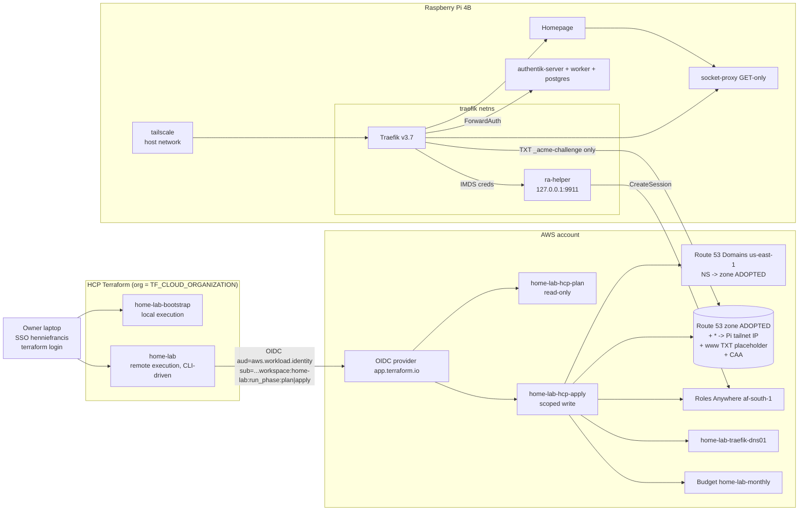

# Phase 1 Build Plan - Edge: Route 53 (adopted into Terraform via HCP Terraform) + Traefik + Socket Proxy + Authentik SSO + Tailscale + Homepage

Status: APPROVED, ready for build (rev 6). All user questions resolved (section 14).
Owner: Hennie Francis
Author: Solutions Architect (dev-team pipeline)
Date: 2026-11-07

> NOTE: This file is written into the OLD working copy at `A:\henniefrancis\home-lab`. Its `origin` still points at
> `home-lab.git`, which GitHub redirects to the private `home-lab-archive`. **Never push from that working copy.**
> The developer builds the new repo in a fresh directory with a clean `git init`, and carries this file into the first
> commit as `docs/plan/phase-1-traefik.md` (task T1). This document is self-contained. Earlier revisions are not needed.
>
> **Working agreements (owner):**
> - The owner reviews **milestone by milestone**. Stop at the end of each milestone for review and approval.
> - GitHub Actions is capped at **100 min/month while the repo is private**. Keep CI lean (T2).
> - Developer docs are mirrored to the Obsidian vault **"Hennie Francis"**, folder **"Home Lab"**.
> - **From now on, no console or CLI changes to Route 53 or Route 53 Domains.** Every DNS change goes through Terraform (golden rule).

Revision history:
- rev 1-2: initial plan; subdomains; Homepage; GitHub archive.
- rev 3: Route 53 + Terraform; Roles Anywhere; apex/`www` reserved; `dashboard.`; wildcard-only cert; per-app forward auth.
- rev 4: registrar is Route 53 Domains; AWS preflight; budget; CAA.
- rev 5: state in HCP Terraform, remote runs with OIDC dynamic credentials, bootstrap workspace.
- rev 6 (2026-11-07):
  - The owner already moved DNS to Route 53 by hand and deleted the Cloudflare account. Verified on public DNS: the NS are 4 `awsdns` servers, the SOA comes from Route 53, and there is no DS record at the `co.za` parent, so DNSSEC is off.
  - The **Cloudflare migration has been removed entirely.** It is replaced by **adopting the existing hosted zone, records and registered-domain NS into Terraform** with `import` blocks and no-op plans.
  - Milestones renumbered to M0-M6.
  - Pi-side details restored in full, so the document stands on its own.

---

## 1. Summary

Rebuild the Raspberry Pi 4B home lab as a fresh, public GitHub repo, starting with a hardened edge layer.

**AWS side (Terraform, with state in HCP Terraform):**
- The domain `example.com` is registered with **Amazon Route 53 Domains**. It is already delegated to a Route 53 public hosted zone that the owner created by hand.
- Phase 1 **adopts** the zone, its existing records and the registered domain's nameserver setting into Terraform, **without recreating anything**. It then adds the lab records.
- It also creates:
  - the IAM role Traefik uses for DNS-01, reached via **IAM Roles Anywhere** (no long-lived keys)
  - a USD 5 budget alert
- HCP Terraform runs authenticate to AWS through **OIDC dynamic credentials**.

**Pi side:**
- **Traefik v3** is the only ingress (80/443), with a **read-only socket proxy**.
- One **Let's Encrypt wildcard `*.${DOMAIN}`** certificate via Route 53 DNS-01.
- **Authentik** SSO + MFA with **per-app forward auth** (host-only cookies).
- **Tailscale** for remote access.
- **Homepage** at `https://dashboard.${DOMAIN}`.

**Domain layout:**
- The apex `${DOMAIN}` and `www.${DOMAIN}` are **reserved for a future public website on EC2**. That website is out of scope, and the Pi never serves these names.
- Every other subdomain is home lab: private (LAN `10.0.0.0/24` + tailnet `100.64.0.0/10`) and Authentik-authenticated.
- No port-forwards.

**Hard requirements:**
- Never type a port.
- Everything uses Let's Encrypt TLS.
- Start from `dashboard.${DOMAIN}`.

**Phase 1 is done when all of the following hold:**
1. The hosted zone, all its records and the registered domain's NS are managed by Terraform (HCP remote runs), and a fresh plan shows no changes.
2. `https://dashboard.${DOMAIN}` and `https://traefik.${DOMAIN}` serve the production LE wildcard behind Authentik + MFA, from the LAN and over Tailscale only.
3. No apex or `www` record points at the Pi.
4. The repo is public with a clean history.

**Out of scope:**
- The EC2 website.
- **Route 53 DNSSEC signing (Phase 2).**
- VCS-triggered Terraform runs.
- Managing HCP objects with the `tfe` provider (Phase 2).
- A blog post (docs stay public-friendly).

## 2. Assumptions and decisions

| # | Item | Status |
|---|------|--------|
| A1 | Raspberry Pi OS 64-bit (arm64 userland); Docker from Docker's apt repo; Compose >= 2.20 | ASSUMPTION, verified by `scripts/preflight.sh` |
| A2 | Boot device | Preflight WARN; SSD recommended (R5) |
| A3 | Pi IP | U5 DHCP reservation |
| A4 | SSH | Preflight reports it. Key-only SSH is recommended; Pi Connect is the break-glass |
| A5 | **Existing Route 53 state** | **FACT (2026-11-07):** the zone was created by hand and the registered domain's NS were set by hand to the 4 `awsdns` servers. Exact records and any duplicate zones are unknown, so `aws-preflight.sh` lists them (6.9) |
| A6 | DNSSEC | **FACT:** off (no DS at the `co.za` parent). Phase 2 item |
| A7 | Cloudflare | **Gone:** account deleted, so the leaked token is dead. The old dashboard hash and Meilisearch key are moot (clean rebuild) |
| A8 | HSTS | `includeSubDomains` on lab hosts only; no preload |
| A9 | Licence | MIT |
| A10 | ACME email | Optional; user-supplied in gitignored `.env` (`.example` uses `you@example.com`) |
| A11 | Update bot | Dependabot (docker-compose, docker, terraform, github-actions), weekly and grouped |
| A12 | Hostnames | `dashboard.`, `traefik.`, `auth.`, `bg-traefik.` (break-glass). Future: `ha.`, `tools.`, `links.`, `netdata.`, `pihole.`, `portainer.`. **Reserved:** apex, `www` |
| A13 | GitHub | `home-lab-archive` is private. The new `home-lab` stays PRIVATE until the end of M6 |
| A14 | AWS login | IAM Identity Center profile `henniefrancis`, used only for the bootstrap and the read-only preflight. The account ID is read via `sts get-caller-identity` and never committed |
| A15 | af-south-1 / SCPs | Gated by `aws-preflight.sh` |
| A16 | Budget | USD 5/month. The email is a sensitive HCP workspace variable set by the owner |
| A17 | CAA | `0 issue "letsencrypt.org"`, `0 issuewild "letsencrypt.org"`, `0 issue "amazon.com"` |
| A18 | Terraform runs | HCP Terraform, remote execution, CLI-driven. Every apply needs owner approval. No AWS or HCP credentials in CI |
| A19 | HCP org name | Never hard-coded: `TF_CLOUD_ORGANIZATION` env var, plus the `hcp_organization` variable in bootstrap |
| A20 | HCP objects | Project `home-lab`. Workspace `home-lab-bootstrap` (local execution, state only) and workspace `home-lab` (remote, CLI-driven, auto-apply off, destroy plans disabled). The owner creates them in the UI |
| A21 | State contents | No secrets by design. The only sensitive datum is the budget email, marked sensitive (R28) |

## 3. Architecture

### 3.1 Diagram



### 3.2 Request flow for `https://dashboard.${DOMAIN}`

1. **DNS:** the wildcard `*.${DOMAIN}` A record returns the Pi's tailnet IP. `www` is excluded by an explicit TXT placeholder, and the apex has no A record pointing at the Pi. LAN clients without Tailscale use hosts-file entries until Pi-hole arrives.
2. **Redirect:** `:80` gets a 308 to `:443`.
3. **Middleware chain:** `lan-allowlist@file`, then `security-headers@file`, then `authentik@file`.
4. **Authentication:** an unauthenticated user goes via `/outpost.goauthentik.io/` on the same host to `auth.${DOMAIN}` for login + MFA, then gets a **host-only** cookie. The Authentik session on `auth.` gives silent SSO to the next app.
5. **Routing:** Traefik forwards to Homepage `:3000`.

### 3.3 HCP Terraform bootstrap design

1. **The owner creates in the HCP UI:**
   - the org (if new) and project `home-lab`
   - workspace `home-lab-bootstrap` (CLI-driven, **Local** execution)
   - workspace `home-lab` (CLI-driven, **Remote** execution, auto-apply off, destroy plans disabled)

   These are a documented exception. They are Terraform's own control plane, not cloud infrastructure. Managing them with `tfe` is Phase 2.
2. **`terraform/bootstrap`** runs once from the laptop with SSO profile `henniefrancis`; its state is stored in HCP. It creates:
   - the `app.terraform.io` OIDC provider
   - the role `home-lab-hcp-plan` (read-only, trusted for `run_phase:plan`)
   - the role `home-lab-hcp-apply` (scoped write, trusted for `run_phase:apply`)

   Run-role changes are only ever made here.
3. **The owner sets the `home-lab` workspace variables:** env vars `TFC_AWS_PROVIDER_AUTH=true`, `TFC_AWS_PLAN_ROLE_ARN`, `TFC_AWS_APPLY_ROLE_ARN`, `AWS_REGION=af-south-1`, plus the Terraform variables in 6.7.2. From then on `terraform/edge` runs remotely.
4. **Why split roles:** a malicious or mistaken plan can't write to AWS. The fallback is one role trusted for `run_phase:*`.
5. **Why CLI-driven:** VCS-driven pull-request plans on a public repo would run untrusted HCL with AWS credentials.

### 3.4 Key decisions and rejected alternatives

| Decision | Chosen | Rejected and why |
|----------|--------|------------------|
| Existing DNS | **Adopt** the hand-made zone, records and registered-domain NS via `import` blocks. The first plan is a no-op apart from tags; later changes are reviewed plans. | Recreating the zone (new NS, an outage, needless NS churn). Leaving it unmanaged (golden rule; drift). |
| Duplicate zones | If more than one zone exists for the domain, the **real** zone is the one whose NS set equals the registered domain's NS. Any other zone is imported into a separate `aws_route53_zone.duplicate[...]` resource (no `prevent_destroy`, `force_destroy = true`). It is then **removed from config so Terraform deletes it**, with owner approval. | Console deletion (golden rule). Leaving it (cost, confusion). |
| Registrar NS | `aws_route53domains_registered_domain` (provider alias us-east-1), imported. The `name_server` values are copied **exactly** from the current registration, and a `check` block asserts they equal the zone's NS set. `prevent_destroy`. | `aws_route53domains_domain` (it registers, renews and deregisters; banned). Console edits. |
| DNS-01 credentials | IAM Roles Anywhere: an offline CA, a key generated on the Pi, a 1-year leaf cert, and 1-hour STS sessions via an `aws_signing_helper serve` sidecar in Traefik's netns. | IAM user access key (secret in state or console-made; long-lived). AWS Private CA (cost). `credential_process` in the musl-based Traefik image. `update` mode (keys on disk, no refresh). |
| State and execution | HCP Terraform, remote, OIDC dynamic credentials, split plan/apply roles, CLI-driven. | S3 state (superseded by the owner playbook). Static keys in HCP. VCS-driven runs. |
| Certificate | One LE `*.${DOMAIN}`. | Apex SAN (apex is not on the Pi). Per-host certs (Certificate Transparency leakage). |
| `www` before the website | Terraform TXT placeholder at `www`. Per Route 53 docs, the wildcard only answers names with no records of any type. | Letting the wildcard catch `www`. |
| Auth | Per-app `forward_single` with host-only cookies. | A domain-wide cookie (it would be sent to the public website). |
| Static config | Compose `command:` flags, interpolated from `.env`. | `traefik.yml` (no interpolation; mutually exclusive with CLI flags). |
| Docker discovery | `tecnativa/docker-socket-proxy`, internal network, GET-only; used by Traefik and Homepage. | Raw `docker.sock`. |
| Dashboard | Homepage, config-as-code. | Homarr (DB/UI config); Heimdall. |
| Tailscale | Container, host network, kernel networking, `tag:homelab`, no subnet router. | Host install (not pinned in git); subnet router (blast radius). |
| Data | Repo at `/opt/home-lab`; runtime data in `/apps/<service>/`. | Named volumes; data in the repo. |
| Secrets | Password manager, plus Pi `secrets/` (dir 700, files 400/600) via Compose secrets, `_FILE`, `file://` and `HOMEPAGE_FILE_*`. None in Terraform, git or CI. | `.env` secrets (visible in `docker inspect` and to socket-proxy consumers). |

## 4. Tech stack and pinned versions

| Component | Version | Verified at |
|-----------|---------|-------------|
| Traefik | `traefik:v3.7.17` | GitHub releases ("Latest", 30 Oct 2026) |
| Docker socket proxy | `tecnativa/docker-socket-proxy:v0.5.0` | GitHub / Docker Hub (27 Jul 2026, arm64) |
| Authentik | `ghcr.io/goauthentik/server:2026.8.5` | GitHub releases ("Latest", 21 Oct 2026); official compose default |
| PostgreSQL | `postgres:16.15-alpine3.24` | Docker Hub (26 Oct 2026) |
| Tailscale | `tailscale/tailscale:v1.104.4` | Docker Hub (28 Oct 2026) |
| Homepage | `ghcr.io/gethomepage/homepage:v2.7.0` | GitHub releases ("Latest", 23 Oct 2026) |
| Break-glass holder | `traefik/whoami:v1.12.0` | Docker Hub (29 Jul 2026) |
| Roles Anywhere helper | `aws_signing_helper` 1.8.5 Linux Aarch64, SHA256 `3d131aa888cd56da446f9c6bb460b1f0569f6c7edc74eae6193a2fe3928883ba` | AWS Roles Anywhere user guide (24 Aug 2026) |
| ra-helper base | `debian:trixie-slim` pinned by digest at build | Debian 13, glibc 2.41 (helper needs >= 2.34) |
| Terraform | 1.17.1 (`~> 1.17`) | GitHub releases (28 Oct 2026) |
| AWS provider | 6.71.0 (`~> 6.71`); lock file committed | GitHub releases (28 Oct 2026) |

Re-verify every version on build day if more than 2 weeks have passed. Verify arm64 images with `docker manifest inspect`.

**Tooling:** gitleaks, yamllint, shellcheck, `terraform fmt`/`validate`, tflint (AWS ruleset), `trivy config`, `docker compose config`, GitHub secret scanning + push protection.

**Official sources:**
- **HCP Terraform dynamic credentials (AWS):** https://developer.hashicorp.com/terraform/cloud-docs/dynamic-provider-credentials/aws-configuration
- **Route 53:**
  - IAM condition keys: https://docs.aws.amazon.com/Route53/latest/DeveloperGuide/specifying-rrset-conditions.html
  - Wildcard behaviour: https://docs.aws.amazon.com/Route53/latest/DeveloperGuide/DomainNameFormat.html
- **Terraform AWS provider:**
  - `route53domains_registered_domain` (adopts and does not register; destroy only removes it from state; import by domain name): https://registry.terraform.io/providers/hashicorp/aws/latest/docs/resources/route53domains_registered_domain
  - `aws_route53_zone` and `aws_route53_record` import docs (record import ID `ZONEID_name_TYPE[_SETIDENTIFIER]`)
- **lego route53:** https://go-acme.github.io/lego/dns/route53/
- **Roles Anywhere:**
  - https://docs.aws.amazon.com/rolesanywhere/latest/userguide/credential-helper.html
  - https://docs.aws.amazon.com/rolesanywhere/latest/userguide/trust-model.html
  - https://docs.aws.amazon.com/general/latest/gr/rolesanywhere.html (af-south-1 supported)
- **Authentik:**
  - https://docs.goauthentik.io/install-config/install/docker-compose/
  - https://docs.goauthentik.io/install-config/configuration/
  - https://docs.goauthentik.io/add-secure-apps/providers/proxy/server_traefik/
  - https://docs.goauthentik.io/customize/blueprints/v1/tags/
- **Homepage:**
  - https://gethomepage.dev/installation/docker/
  - https://gethomepage.dev/configs/docker/
- **Compose include:** https://docs.docker.com/reference/compose-file/include/
- **Tailscale:** https://tailscale.com/docs/features/containers/docker/docker-params

## 5. Repo layout (new repo)

```
home-lab/
  README.md  LICENSE (MIT)  SECURITY.md
  .gitignore            # .env, secrets/* (keep .gitkeep, README.md), acme*.json, *.log, homepage/config/logs/,
                        # **/.terraform/, *.tfstate*, *.tfvars, *.auto.tfvars (keep *.example), *.pem, *.key, *.csr,
                        # crash.log, adopt-snapshot/
  .gitattributes        # * text=auto eol=lf
  .editorconfig  .pre-commit-config.yaml  .yamllint.yaml  .tflint.hcl
  .env.example
  compose.yaml          # include: traefik, authentik, tailscale, homepage
  .github/dependabot.yml  .github/workflows/ci.yml
  terraform/
    bootstrap/  versions.tf providers.tf oidc.tf roles.tf variables.tf outputs.tf terraform.tfvars.example
    edge/       versions.tf providers.tf variables.tf route53.tf records.tf domains.tf imports.tf checks.tf
                iam-dns01.tf rolesanywhere.tf budget.tf outputs.tf workspace-variables.example.md
  pki/  README.md openssl-ca.cnf openssl-leaf.cnf
  scripts/
    aws-preflight.sh    # read-only AWS + HCP gate; lists zones, records, registered NS (6.9)
    preflight.sh  bootstrap.sh  gen-secrets.sh  deploy.sh  cert-expiry.sh
    pki-new-ca.sh  pki-pi-csr.sh  pki-sign-pi.sh
  secrets/  .gitkeep  README.md
  traefik/  compose.yaml  ra-helper/Dockerfile  dynamic/middlewares.yml  dynamic/tls.yml
  authentik/ compose.yaml  blueprints/homelab-apps.yaml
  homepage/  compose.yaml  config/{settings,services,bookmarks,widgets,docker}.yaml custom.css custom.js
  tailscale/ compose.yaml  policy.example.hujson
  docs/plan/phase-1-traefik.md
  docs/runbooks/ first-deploy.md hcp-terraform-bootstrap.md adopt-existing-route53.md rolesanywhere-pki.md
                 cert-staging-to-prod.md break-glass.md rotate-secrets.md add-a-service.md
```

Root `compose.yaml`:

```yaml
name: home-lab
include:
  - traefik/compose.yaml
  - authentik/compose.yaml
  - tailscale/compose.yaml
  - homepage/compose.yaml
```

A single root `.env` applies to all included files. Per the Compose docs, the project environment takes precedence over each include's own `.env`.

`.env.example` (the real file is `/opt/home-lab/.env`, mode 600):

```dotenv
DOMAIN=example.com
PI_LAN_IP=10.0.0.10
LAN_CIDR=10.0.0.0/24
TAILNET_CIDR=100.64.0.0/10
TZ=Africa/Johannesburg
ACME_EMAIL=you@example.com
ACME_ENV=staging
ACME_CA_SERVER=https://acme-staging-v02.api.letsencrypt.org/directory
# prod: https://acme-v02.api.letsencrypt.org/directory
APPS_ROOT=/apps
PROXY_SUBNET=172.30.0.0/24
TS_HOSTNAME=homelab-pi
PUID=1000
PGID=1000
# from `terraform output` of the home-lab workspace (not secret; account-identifying, so keep out of git)
ROUTE53_ZONE_ID=
RA_TRUST_ANCHOR_ARN=
RA_PROFILE_ARN=
RA_ROLE_ARN=
```

**Secret files on the Pi** (`/opt/home-lab/secrets/`). These are never committed and never printed to a terminal or agent context.

| File | Contents | Consumer | Owner:mode |
|------|----------|----------|------------|
| `rolesanywhere/pi.key` | ECDSA P-256 key generated on the Pi | ra-helper | 10001:10001 0400 |
| `rolesanywhere/pi.crt` | leaf cert (public) | ra-helper | 10001:10001 0444 |
| `authentik_secret_key` | `openssl rand -base64 60` | Authentik `file://` | 1000:1000 0400 |
| `authentik_pg_password` | `openssl rand -base64 36` | Postgres `POSTGRES_PASSWORD_FILE`, Authentik `file://` | 1000:1000 0400 (dev to verify the Postgres read path) |
| `breakglass_users` | htpasswd bcrypt line | Traefik basicAuth `usersFile` | root:root 0400 |
| `tailscale.env` | `TS_AUTHKEY=` (one-off key); emptied after join | tailscale `env_file` | root:root 0600 |
| `homepage_authentik_token` (optional) | read-only Authentik API token | `HOMEPAGE_FILE_AUTHENTIK_TOKEN` | 1000:1000 0400 |

**Offline and laptop secrets:**
- CA private key: kept in the password manager.
- HCP user token: in `%APPDATA%\terraform.d\credentials.tfrc.json`, created by `terraform login`. Never print it.

## 6. Specifications

### 6.1 Docker networks (created by `bootstrap.sh`, `external: true`)

| Network | Flags | Members |
|---------|-------|---------|
| `proxy` | bridge, `--subnet ${PROXY_SUBNET}` | traefik (and ra-helper via shared netns), authentik-server, homepage, future services |
| `socket-proxy` | bridge, `--internal` | traefik, homepage, socket-proxy |
| `authentik-internal` | bridge, `--internal` | authentik-server, authentik-worker, authentik-postgresql |

- Traefik and the ra-helper reach Let's Encrypt, `route53.amazonaws.com`, STS and `rolesanywhere.af-south-1.amazonaws.com` via `proxy`.
- If the Authentik worker needs egress (update checks, GeoIP), the dev adds it to `proxy` and documents why.
- Every service uses `logging: {driver: json-file, options: {max-size: 10m, max-file: "3"}}`.

### 6.2 Traefik + ra-helper + socket proxy + break-glass (`traefik/compose.yaml`)

**traefik**
- Hardening: `restart: unless-stopped`, `read_only: true`, `security_opt: [no-new-privileges:true]`, `cap_drop: [ALL]`, `cap_add: [NET_BIND_SERVICE]`, memory 256M, `TZ`, healthcheck `traefik healthcheck --ping`.
- Ports: `80:80` and `443:443` only. No 8080.
- Mounts: `./dynamic:/etc/traefik/dynamic:ro`, `${APPS_ROOT}/traefik/letsencrypt:/letsencrypt`, `${APPS_ROOT}/traefik/logs:/logs`.
- Secrets: `breakglass_users`.
- Environment: `AWS_REGION=us-east-1`, `AWS_HOSTED_ZONE_ID=${ROUTE53_ZONE_ID}`, `AWS_EC2_METADATA_SERVICE_ENDPOINT=http://127.0.0.1:9911`. No static AWS keys or profile. `AWS_EC2_METADATA_DISABLED` must be unset.
- Static config via `command:`. Validate every flag against the Traefik v3.7 reference.

```
--global.checkNewVersion=false
--global.sendAnonymousUsage=false
--log.level=INFO
--log.format=json
--accesslog=true
--accesslog.format=json
--accesslog.filepath=/logs/access.log
--ping=true
--api.dashboard=true
--api.insecure=false
--providers.docker.endpoint=tcp://socket-proxy:2375
--providers.docker.exposedByDefault=false
--providers.docker.network=proxy
--providers.file.directory=/etc/traefik/dynamic
--providers.file.watch=true
--entrypoints.web.address=:80
--entrypoints.web.http.redirections.entrypoint.to=websecure
--entrypoints.web.http.redirections.entrypoint.scheme=https
--entrypoints.web.http.redirections.entrypoint.permanent=true
--entrypoints.websecure.address=:443
--entrypoints.websecure.asDefault=true
--entrypoints.websecure.http.tls.certResolver=le
--entrypoints.websecure.http.tls.options=modern@file
--entrypoints.websecure.http.tls.domains[0].main=*.${DOMAIN}
--entrypoints.websecure.http.middlewares=security-headers@file
--certificatesresolvers.le.acme.email=${ACME_EMAIL}
--certificatesresolvers.le.acme.caServer=${ACME_CA_SERVER}
--certificatesresolvers.le.acme.storage=/letsencrypt/acme-${ACME_ENV}.json
--certificatesresolvers.le.acme.dnsChallenge.provider=route53
--certificatesresolvers.le.acme.dnsChallenge.resolvers=1.1.1.1:53,8.8.8.8:53
```

Notes:
- Separate ACME storage per CA, so the staging-to-prod switch is a clean, reversible `.env` change.
- Public resolvers are used for the propagation check, so a future Pi-hole can't break it.

Router labels:

```yaml
traefik.enable: "true"
traefik.http.routers.dashboard.rule: Host(`traefik.${DOMAIN}`)
traefik.http.routers.dashboard.entrypoints: websecure
traefik.http.routers.dashboard.service: api@internal
traefik.http.routers.dashboard.middlewares: lan-allowlist@file,authentik@file
traefik.http.routers.dashboard-outpost.rule: Host(`traefik.${DOMAIN}`) && PathPrefix(`/outpost.goauthentik.io/`)
traefik.http.routers.dashboard-outpost.entrypoints: websecure
traefik.http.routers.dashboard-outpost.service: authentik
traefik.http.routers.dashboard-outpost.middlewares: lan-allowlist@file
traefik.http.routers.dashboard-outpost.priority: "100"
traefik.http.middlewares.breakglass-auth.basicauth.usersfile: /run/secrets/breakglass_users
```

During M3, before Authentik exists, the dashboard router temporarily uses `lan-allowlist@file,breakglass-auth@docker`.

**ra-helper**
- `build: ./ra-helper` produces image `home-lab/ra-helper:1.8.5`. The Dockerfile:
  - `FROM debian:trixie-slim@sha256:<digest>`
  - installs `ca-certificates`
  - `ADD --checksum=sha256:3d131aa8... https://rolesanywhere.amazonaws.com/releases/1.8.5/Aarch64/Linux/Amzn2023/aws_signing_helper /usr/local/bin/`
  - `chmod 0555`
  - `USER 10001`
- `network_mode: "service:traefik"`. The helper only listens on 127.0.0.1, so only Traefik can reach it.
- `command: serve --certificate /run/secrets/ra_pi_crt --private-key /run/secrets/ra_pi_key --trust-anchor-arn ${RA_TRUST_ANCHOR_ARN} --profile-arn ${RA_PROFILE_ARN} --role-arn ${RA_ROLE_ARN} --session-duration 3600 --port 9911 --hop-limit 1`
- Hardening: `read_only`, `cap_drop ALL`, `no-new-privileges`, memory 64M, `restart: unless-stopped`, `depends_on: [traefik]`.
- **Caveat:** if Traefik is recreated, the helper must be recreated too. `deploy.sh` always runs `up -d`, and the runbook covers manual restarts.
- The dev may use the official `public.ecr.aws/rolesanywhere/credential-helper` instead, if a pinned arm64 tag is confirmed working on the Pi.

**socket-proxy**
- `tecnativa/docker-socket-proxy:v0.5.0` with `CONTAINERS=1 EVENTS=1 VERSION=1 PING=1 POST=0`; all other sections are 0.
- `/var/run/docker.sock:/var/run/docker.sock:ro`.
- Network `socket-proxy` only; no published ports; memory 64M; `no-new-privileges`; `read_only` with tmpfs `/run` if needed (dev to verify).

**breakglass** (Compose `profiles: [breakglass]`)
- `traefik/whoami:v1.12.0` with router `bg-traefik` (`Host(bg-traefik.${DOMAIN})`), service `api@internal`, middlewares `lan-allowlist@file,breakglass-auth@docker`.
- Enable with `docker compose --profile breakglass up -d breakglass`; disable with `docker compose rm -sf breakglass`.

### 6.3 Traefik dynamic config (`traefik/dynamic/`)

`middlewares.yml`:

```yaml
http:
  middlewares:
    lan-allowlist:
      ipAllowList:
        sourceRange: ["10.0.0.0/24", "100.64.0.0/10"]   # keep in sync with LAN_CIDR / TAILNET_CIDR
    security-headers:
      headers:
        stsSeconds: 300                 # raise to 31536000 at M6
        stsIncludeSubdomains: true
        stsPreload: false
        forceSTSHeader: true
        contentTypeNosniff: true
        frameDeny: true
        referrerPolicy: strict-origin-when-cross-origin
        permissionsPolicy: "camera=(), microphone=(), geolocation=(), payment=()"
        customResponseHeaders:
          X-Robots-Tag: "noindex, nofollow"
          Server: ""
    authentik:
      forwardAuth:
        address: http://authentik-server:9000/outpost.goauthentik.io/auth/traefik
        trustForwardHeader: true
        maxResponseBodySize: 4194304
        authResponseHeaders:
          - X-authentik-username
          - X-authentik-groups
          - X-authentik-entitlements
          - X-authentik-email
          - X-authentik-name
          - X-authentik-uid
          - X-authentik-jwt
          - X-authentik-meta-jwks
          - X-authentik-meta-outpost
          - X-authentik-meta-provider
          - X-authentik-meta-app
          - X-authentik-meta-version
```

- `trustForwardHeader` is safe only because Traefik is the edge and no `forwardedHeaders.trustedIPs` is set.
- `preflight.sh` warns if `LAN_CIDR` differs from this file.

`tls.yml`:

```yaml
tls:
  options:
    modern:
      minVersion: VersionTLS12
      sniStrict: true
```

### 6.4 Authentik (`authentik/compose.yaml`)

This is based on the official 2026.8.5 compose (no Redis), with these deviations: no published ports, no `docker.sock`, `file://` secrets, memory limits, internal networks, a blueprints mount, and a pinned Postgres patch version.

**authentik-postgresql**
- `postgres:16.15-alpine3.24`
- Environment: `POSTGRES_DB=authentik`, `POSTGRES_USER=authentik`, `POSTGRES_PASSWORD_FILE=/run/secrets/authentik_pg_password`
- Volume: `${APPS_ROOT}/authentik/postgres:/var/lib/postgresql/data`
- Healthcheck: `pg_isready -d authentik -U authentik` (30s / 5s / 5 / 20s)
- `authentik-internal` only; memory 512M

**authentik-server**
- `command: server`; networks `proxy` + `authentik-internal`; `depends_on` postgres healthy; memory 1G
- Environment:
  - `AUTHENTIK_POSTGRESQL__HOST=authentik-postgresql`
  - `AUTHENTIK_POSTGRESQL__NAME=authentik`
  - `AUTHENTIK_POSTGRESQL__USER=authentik`
  - `AUTHENTIK_POSTGRESQL__PASSWORD=file:///run/secrets/authentik_pg_password`
  - `AUTHENTIK_SECRET_KEY=file:///run/secrets/authentik_secret_key`
  - `AUTHENTIK_LISTEN__TRUSTED_PROXY_CIDRS=${PROXY_SUBNET}`
  - `AUTHENTIK_ERROR_REPORTING__ENABLED=false`
  - `DOMAIN=${DOMAIN}`
  - **`AUTHENTIK_COOKIE_DOMAIN` unset**, so cookies are host-only
- Mounts: `${APPS_ROOT}/authentik/data:/data`, `${APPS_ROOT}/authentik/custom-templates:/templates`, `./blueprints:/blueprints/custom:ro` (dev to confirm the path)
- Labels: router `authentik`, `Host(auth.${DOMAIN})`, `websecure`, middleware `lan-allowlist@file`, service port 9000, `traefik.docker.network=proxy`

**authentik-worker**
- `command: worker`; same environment and secrets; `/data`, `/certs`, blueprints mounts; `authentik-internal`; memory 1G; **no `docker.sock`**

**Blueprint `homelab-apps.yaml`**
- One `forward_single` proxy provider per app, with `external_host` `https://dashboard.<DOMAIN>` and `https://traefik.<DOMAIN>` (built with `!Format` / `!Env DOMAIN`).
- Applications `homepage` and `traefik`.
- Both providers added to the embedded outpost (`!Find`).
- Group `homelab-admins` bound to both.
- If any field misbehaves, document the UI steps as a fallback.

**First-run hardening (owner, U10)**
1. Run the initial setup at `https://auth.${DOMAIN}/if/flow/initial-setup/`.
2. Create a personal admin in `homelab-admins` with WebAuthn or TOTP.
3. Enforce MFA in the authentication flow.
4. Deactivate `akadmin`, or protect it with MFA.
5. Test recovery: `docker compose exec authentik-worker ak create_recovery_key 1 <user>`.

### 6.5 Tailscale (`tailscale/compose.yaml`)

- `tailscale/tailscale:v1.104.4`, `network_mode: host`, `restart: unless-stopped`.
- `devices: [/dev/net/tun:/dev/net/tun]`, `cap_add: [NET_ADMIN]` (dev to confirm the minimal set; `tun` is preloaded by bootstrap).
- Environment: `TS_HOSTNAME`, `TS_STATE_DIR=/var/lib/tailscale`, `TS_USERSPACE=false`, `TS_AUTH_ONCE=true`, `TS_ACCEPT_DNS=false`, `TS_EXTRA_ARGS=--advertise-tags=tag:homelab`.
- `env_file: ../secrets/tailscale.env`.
- Volume `${APPS_ROOT}/tailscale/state:/var/lib/tailscale`; memory 128M.
- `policy.example.hujson`: `tag:homelab` owned by `autogroup:admin`; grant `autogroup:member` access to `tag:homelab` on tcp 443/80/22 only.
- The Pi joins in M2, **before** the wildcard record is applied, because the record holds its tailnet IP.

### 6.6 Homepage (`homepage/compose.yaml`)

- `ghcr.io/gethomepage/homepage:v2.7.0`, memory 256M, `no-new-privileges`, `cap_drop ALL`, networks `proxy` + `socket-proxy`, no published ports.
- Environment: `HOMEPAGE_ALLOWED_HOSTS=dashboard.${DOMAIN}`, `PUID`, `PGID`, `TZ`, `HOMEPAGE_VAR_DOMAIN=${DOMAIN}`. Optional: `HOMEPAGE_FILE_AUTHENTIK_TOKEN=/run/secrets/homepage_authentik_token`.
- Mounts: `./config:/app/config` (try `:ro`) and `${APPS_ROOT}/homepage/logs:/app/config/logs`. If a read-only mount isn't possible, `deploy.sh` warns when the tree is dirty.
- Labels:
  - router `homepage`: `Host(dashboard.${DOMAIN})`, middlewares `lan-allowlist@file,authentik@file`, port 3000
  - router `homepage-outpost`: `Host(dashboard.${DOMAIN}) && PathPrefix(/outpost.goauthentik.io/)` -> service `authentik`, priority 100
- `docker.yaml`: `homelab: {host: socket-proxy, port: 2375}`.
- `services.yaml`:
  - Infrastructure (live, with `server: homelab` + `container`): Traefik (`https://traefik.{{HOMEPAGE_VAR_DOMAIN}}`) and Authentik (`https://auth.{{HOMEPAGE_VAR_DOMAIN}}`).
  - "Apps (coming soon)" placeholders: Home Assistant `ha.`, IT Tools `tools.`, Linkwarden `links.`, Netdata `netdata.`, Pi-hole `pihole.`, Portainer `portainer.`.
  - No ports anywhere.
- `widgets.yaml`: resources and datetime. `bookmarks.yaml`: AWS console (Route 53), Tailscale admin, GitHub repo.
- Widget keys are only ever passed via `HOMEPAGE_FILE_*`.

### 6.7 Terraform

**Conventions:**
- All AWS resources via Terraform. Hyphens only, no em dashes, in names and descriptions.
- `default_tags`: `Project=home-lab`, `ManagedBy=terraform`, `Owner=hennie`, `Repo=github.com/henniefrancis/home-lab`.
- No org name, account ID, domain, zone ID or email in git.
- Lock files committed.
- `prevent_destroy` on the OIDC provider, both run roles, the primary zone and the registered domain.
- **The developer loads the `aws-iam` skill (and `aws-secrets-manager` per the global rules) before IAM, OIDC or Roles Anywhere work.** Never print secret values.

#### 6.7.1 `terraform/bootstrap` (workspace `home-lab-bootstrap`, local execution, SSO profile)

- Variables come from gitignored `terraform.tfvars`: `aws_profile` (`henniefrancis`), `hcp_organization`, `hcp_project` (`home-lab`), `hcp_workspace` (`home-lab`), `domain`.
- **`oidc.tf`:** `aws_iam_openid_connect_provider` with `url = "https://app.terraform.io"` and `client_id_list = ["aws.workload.identity"]`. Omit the thumbprint if provider 6.71 allows it; otherwise use the `tls_certificate` data source. Import it if it already exists.
- **`roles.tf`:** both roles have `max_session_duration = 3600` and `prevent_destroy`. Trust is `sts:AssumeRoleWithWebIdentity` with `StringEquals`:
  - `app.terraform.io:aud = aws.workload.identity`
  - `app.terraform.io:sub = organization:<org>:project:<project>:workspace:<ws>:run_phase:plan` (plan role), or `...:run_phase:apply` (apply role)
- **Plan role (read-only):**
  - `route53:Get*`, `route53:List*`
  - `route53domains:GetDomainDetail`, `ListTagsForDomain`, `GetOperationDetail`
  - `rolesanywhere:Get*`, `List*`
  - `iam:GetRole`, `GetRolePolicy`, `ListRolePolicies`, `ListAttachedRolePolicies`, `ListRoleTags`
  - `budgets:ViewBudget`, `ListTagsForResource`
  - `sts:GetCallerIdentity`
- **Apply role (scoped write):**

| Statement | Actions | Resource / conditions |
|-----------|---------|-----------------------|
| Route53 | `CreateHostedZone`, `DeleteHostedZone` (needed only for duplicate-zone cleanup; removed again in T5b if unused), `ChangeTagsForResource`, `UpdateHostedZoneComment`, `ChangeResourceRecordSets`, `GetChange`, plus the reads | `hostedzone/*`, `change/*`. `CreateHostedZone` on `*`. Tighten to the zone ARN in T5b |
| Route53Domains | `GetDomainDetail`, `UpdateDomainNameservers`, `EnableDomainAutoRenew`, `DisableDomainAutoRenew`, `EnableDomainTransferLock`, `UpdateTagsForDomain`, `ListTagsForDomain`, `GetOperationDetail` | `*` (no resource-level scoping exists) with `aws:RequestedRegion = us-east-1`. No DS actions in Phase 1 (DNSSEC is Phase 2) |
| DenyDomainDanger | **Deny** `DeleteDomain`, `TransferDomain`, `TransferDomainToAnotherAwsAccount`, `AcceptDomainTransferFromAnotherAwsAccount`, `RejectDomainTransferFromAnotherAwsAccount`, `CancelDomainTransferToAnotherAwsAccount`, `RegisterDomain`, `RenewDomain`, `UpdateDomainContact`, `UpdateDomainContactPrivacy`, `RetrieveDomainAuthCode`, `DisableDomainTransferLock`, `PushDomain`, `AssociateDelegationSignerToDomain`, `DisassociateDelegationSignerFromDomain` | `*` |
| RolesAnywhere | Create/Update/Enable/Disable on TrustAnchor and Profile, `TagResource`, `UntagResource`, `PutNotificationSettings`, `ResetNotificationSettings` | `*` with `aws:RequestedRegion = af-south-1` |
| AcmeRoleOnly | `iam:CreateRole`, `UpdateRole`, `UpdateAssumeRolePolicy`, `PutRolePolicy`, `DeleteRolePolicy`, `TagRole`, `UntagRole`, `DeleteRole` | only `role/home-lab-traefik-dns01` |
| PassAcmeRole | `iam:PassRole` | same ARN; `iam:PassedToService = rolesanywhere.amazonaws.com` |
| Budget | `budgets:ModifyBudget`, `ViewBudget`, `TagResource` | `budget/home-lab-monthly` |

- Neither role gets IAM on the OIDC provider or on `home-lab-hcp-*`, nor `iam:CreateUser`, `iam:CreateAccessKey`, `organizations:*`, `s3:*` or `kms:*`.
- **T5b (M6):** run IAM Access Analyzer policy generation from CloudTrail for both roles, remove unused actions, and re-apply via bootstrap.
- Outputs: `plan_role_arn`, `apply_role_arn`, `oidc_provider_arn`.

#### 6.7.2 `terraform/edge` (workspace `home-lab`, remote execution, dynamic credentials)

`providers.tf`:

```hcl
variable "tfc_aws_dynamic_credentials" {
  description = "Injected by HCP Terraform dynamic provider credentials"
  type = object({
    default = object({ shared_config_file = string })
    aliases = map(object({ shared_config_file = string }))
  })
}
provider "aws" {
  region              = "af-south-1"
  shared_config_files = [var.tfc_aws_dynamic_credentials.default.shared_config_file]
  default_tags { tags = local.tags }
}
provider "aws" {
  alias               = "us_east_1"   # Route 53 Domains API is us-east-1 only
  region              = "us-east-1"
  shared_config_files = [var.tfc_aws_dynamic_credentials.default.shared_config_file]
  default_tags { tags = local.tags }
}
```

The dev must verify that the alias can reuse the default credentials. If it can't, use a tagged alias as described in the HCP docs.

**Workspace variables** (set by the owner in HCP; documented with placeholders in `workspace-variables.example.md`). **No `*.tfvars` or `*.auto.tfvars` files for `edge`**; CLI-driven runs would upload them.

| Name | Kind | Sensitive | Source |
|------|------|-----------|--------|
| `TFC_AWS_PROVIDER_AUTH` | env | no | `true` |
| `TFC_AWS_PLAN_ROLE_ARN`, `TFC_AWS_APPLY_ROLE_ARN` | env | no | bootstrap outputs |
| `domain` | tf | no | the real domain |
| `existing_zone_id` | tf | no | `aws-preflight.sh` (the **delegated** zone) |
| `existing_zone_comment` | tf | no | preflight (mirrored so the adoption plan is a no-op) |
| `registered_name_servers` | tf (HCL list) | no | preflight, **copied exactly, same order** |
| `domain_auto_renew`, `domain_transfer_lock` | tf | no | preflight (mirrored) |
| `existing_records` | tf (HCL map) | no | preflight listing, excluding apex NS/SOA. Each entry: `{ name, type, ttl, records, alias = optional(...), set_identifier = optional(...) }` with values **exactly as found** |
| `duplicate_zone_ids` | tf (HCL list) | no | preflight (expected empty) |
| `pi_tailnet_ipv4` | tf | no | after M2 (`null` before) |
| `ca_cert_pem` | tf (heredoc) | no | public CA cert PEM contents |
| `budget_usd` | tf | no | `5` |
| `budget_email` | tf | **yes** | the owner's own address |

**`imports.tf`** (Terraform >= 1.7, so `for_each` works on import blocks):

```hcl
import {
  to = aws_route53_zone.primary
  id = var.existing_zone_id
}
import {
  for_each = var.existing_records
  to       = aws_route53_record.existing[each.key]
  id       = join("_", compact([var.existing_zone_id, each.value.name, each.value.type, try(each.value.set_identifier, null)]))
}
import {
  provider = aws.us_east_1
  to       = aws_route53domains_registered_domain.this
  id       = var.domain
}
import {
  for_each = toset(var.duplicate_zone_ids)
  to       = aws_route53_zone.duplicate[each.value]
  id       = each.value
}
```

**`route53.tf`:**
- `aws_route53_zone.primary`: `name = var.domain`, `comment = var.existing_zone_comment` (may be changed to "home-lab public zone - managed by Terraform" in a later, reviewed apply), `prevent_destroy`.
- `aws_route53_zone.duplicate`: `for_each` over `duplicate_zone_ids`, `force_destroy = true`, **no** `prevent_destroy`. It exists only so the duplicates can be removed through Terraform.

**`records.tf`:**
- `aws_route53_record.existing`: `for_each = var.existing_records`, recreating each record exactly as found (adopted).
- **Planned lab records, created by Terraform:**
  - `*.${domain}` A -> `var.pi_tailnet_ipv4`, TTL 300 (`count` gated on the variable being set)
  - `www.${domain}` TXT `"reserved for public website"`, TTL 300
  - apex CAA `0 issue "letsencrypt.org"`, `0 issuewild "letsencrypt.org"`, `0 issue "amazon.com"`, TTL 3600
- **Collision rule:** if an existing record has the same name and type as a planned record (for example an existing `*` A, `www` record or apex CAA), the dev **imports it at the planned resource address** with an explicit `import` block. It is left out of `existing_records`, and the value change is made in a separate reviewed apply.
- **Never managed:** apex NS/SOA (owned by the zone) and `_acme-challenge` (owned by Traefik at issuance).
- **Never created:** apex A/AAAA/ALIAS or `www` A/AAAA/CNAME pointing at the Pi, and AAAA records for lab names.

**`domains.tf`:**

```hcl
resource "aws_route53domains_registered_domain" "this" {
  provider    = aws.us_east_1
  domain_name = var.domain
  dynamic "name_server" {
    for_each = var.registered_name_servers          # exactly as currently registered
    content { name = name_server.value }
  }
  auto_renew    = var.domain_auto_renew
  transfer_lock = var.domain_transfer_lock
  # contacts and privacy are NOT managed here
  lifecycle { prevent_destroy = true }
}
```

- `aws_route53domains_domain` is banned in this repo (CI grep guard). That resource can register, renew and deregister domains.

**`checks.tf`:**

```hcl
check "registered_ns_match_zone" {
  assert {
    condition     = toset([for n in var.registered_name_servers : trimsuffix(lower(n), ".")]) == toset([for n in aws_route53_zone.primary.name_servers : trimsuffix(lower(n), ".")])
    error_message = "Registered domain NS do not match the adopted hosted zone NS - wrong zone imported or delegation drift."
  }
}
```

**`iam-dns01.tf`**, role `home-lab-traefik-dns01`:
- Trust: `rolesanywhere.amazonaws.com`, actions `sts:AssumeRole`, `sts:TagSession`, `sts:SetSourceIdentity`. Conditions:
  - `ArnEquals aws:SourceArn` = the trust anchor
  - `StringEquals aws:PrincipalTag/x509Subject/CN = home-lab-pi-traefik`
  - `StringEquals aws:PrincipalTag/x509Issuer/CN = home-lab-offline-ca`
- Inline policy:
  - `route53:GetChange` on `change/*`
  - `route53:ListResourceRecordSets` on the zone
  - `route53:ChangeResourceRecordSets` on the zone, with `ForAllValues:StringEquals`: `ChangeResourceRecordSetsNormalizedRecordNames = ["_acme-challenge.<domain>"]`, `ChangeResourceRecordSetsRecordTypes = ["TXT"]`, `ChangeResourceRecordSetsActions = ["UPSERT","DELETE"]`
- Add `ListHostedZonesByName` or `CREATE` only if Traefik logs show they are needed.
- `max_session_duration = 3600`. Validate with Access Analyzer.

**`rolesanywhere.tf`** (af-south-1):
- Trust anchor `home-lab-offline-ca`: `CERTIFICATE_BUNDLE` from `var.ca_cert_pem`; expiry `notification_settings` if supported.
- Profile `home-lab-traefik`: `duration_seconds = 3600`.
- Revocation is done by setting `enabled = false`.

**`budget.tf`:** `home-lab-monthly`, USD 5, notifications at 80% ACTUAL and 100% FORECASTED to `var.budget_email`.

**`outputs.tf`:** `zone_id`, `name_servers`, `trust_anchor_arn`, `profile_arn`, `role_arn`.

**Rules:**
- Never run `terraform destroy` on `home-lab`; destroy plans are disabled in the workspace.
- **Cost:** about USD 0.50/month per hosted zone (duplicates add to this until removed). Roles Anywhere is free. HCP is on the free tier (owner to confirm the plan).

### 6.8 PKI (Roles Anywhere)

1. **On the laptop**, outside the repo, run `pki-new-ca.sh`. It creates an ECDSA P-384 CA, CN `home-lab-offline-ca`, valid 5 years, with `basicConstraints=critical,CA:true,pathlen:0` and `keyUsage=critical,keyCertSign,cRLSign`. Store `ca.key` in the password manager.
2. **On the Pi**, run `pki-pi-csr.sh`. It creates `secrets/rolesanywhere/pi.key` (P-256, 0400, uid 10001) and `pi.csr` (CN `home-lab-pi-traefik`).
3. **On the laptop**, run `pki-sign-pi.sh`. It signs the CSR with `CA:false`, `digitalSignature`, `clientAuth`, SHA-256, valid 365 days. Copy `pi.crt` back to the Pi.
4. Paste the CA cert PEM into the `ca_cert_pem` workspace variable, then delete the local copy of the CA key.
5. Renew yearly. `cert-expiry.sh` and the preflight WARN at less than 30 days. No script ever echoes key material; they print fingerprints, subjects and expiry dates only.

### 6.9 AWS + HCP preflight (`scripts/aws-preflight.sh`)

Must pass before ANY apply. It is read-only, uses `--profile henniefrancis`, and prints no secrets.

1. **Tooling:** AWS CLI v2; Terraform 1.17.x.
2. **HCP:** `TF_CLOUD_ORGANIZATION` is set; the HCP credentials file is present (presence only); `terraform -chdir=terraform/bootstrap init` succeeds.
3. **Identity:** `aws sts get-caller-identity`. FAIL on an expired SSO session, with a hint to run `aws sso login --profile henniefrancis`.
4. **af-south-1:** `aws account get-region-opt-status --region-name af-south-1`. It must be enabled; if not, FAIL and point to the remedy (R24).
5. **Roles Anywhere:** `aws rolesanywhere list-trust-anchors --region af-south-1` succeeds (also detects an SCP block).
6. **Registration:** `aws route53domains get-domain-detail --region us-east-1`. The domain must be in this account. Print the NS in order, AutoRenew, TransferLock, privacy flags and the DnssecKeys count (expect 0).
7. **Hosted zones (adoption inventory):**
   - `aws route53 list-hosted-zones-by-name --dns-name <domain>`: list every zone with that exact name, showing zone ID, comment, record count, and its NS set (`get-hosted-zone`).
   - Mark as **DELEGATED** the zone whose NS set equals the registered NS set. **FAIL if none match, or if more than one matches.**
   - **WARN for every other zone (DUPLICATE)** and print its ID for `duplicate_zone_ids`, plus its non-NS/SOA record count. Duplicates with records need owner review before removal.
   - For the delegated zone, `aws route53 list-resource-record-sets`: print every record except the apex NS and SOA (name, type, TTL, values, alias target, set identifier) in a copy-ready HCL map format for `existing_records`.
   - Flag **collisions** with planned records (`*` A, `www` any type, apex CAA), any `_acme-challenge` leftovers, and any **apex or `www` address record pointing at a private/CGNAT IP**.
   - Optionally save the listing to `adopt-snapshot/` (gitignored), never committed.
8. **DNSSEC sanity:** `dig +short DS <domain> @<a co.za parent NS>` returns nothing; `dig NS <domain> @1.1.1.1` returns the delegated zone's NS.
9. **Existing IAM:** check for the OIDC provider `app.terraform.io`, and the roles `home-lab-hcp-plan`, `home-lab-hcp-apply` and `home-lab-traefik-dns01`. WARN if any exist, because they must be imported.
10. **Permissions:** `simulate-principal-policy` for the bootstrap actions (WARN-only), and `organizations describe-organization` (WARN-only).

## 7. Well-Architected lens

- **Operational excellence:**
  - Everything is in Terraform, including adopted hand-made DNS.
  - HCP holds state, locking and run history.
  - Preflight gates each apply.
  - Milestone-by-milestone owner review.
  - Runbooks, grouped Dependabot, and lean CI.
- **Security:**
  - No long-lived AWS keys: HCP uses OIDC, the Pi uses Roles Anywhere, the owner uses SSO.
  - Plan and apply roles are split, with trust pinned to the org/project/workspace/phase.
  - The apply role can't escalate privileges and is denied dangerous domain actions.
  - The DNS-01 role is limited to TXT `_acme-challenge`.
  - No secrets in state.
  - The dead Cloudflare account removes the leaked-token risk.
  - LAN/tailnet allowlist, MFA, host-only cookies, and a GET-only socket proxy.
  - No VCS-triggered runs on the public repo.
- **Reliability:**
  - Adoption with no-op plans means no DNS change during adoption.
  - A `check` guards against importing the wrong zone.
  - `prevent_destroy` on the critical resources.
  - Route 53 SLA, persisted ACME state, break-glass and Pi Connect.
- **Performance efficiency:** about 3.4 GB worst-case memory ceiling on 8 GB. The ra-helper is idle except during renewals.
- **Cost optimisation:** about USD 0.5-1/month, plus removal of any duplicate zones. USD 5 budget alert. Self-managed CA. HCP free tier.
- **Sustainability:** one ARM host and managed services.

## 8. Phased delivery plan (owner review and approval at the end of EVERY milestone)

| Milestone | Depends on | Acceptance |
|-----------|-----------|------------|
| **M0 - Repo reset** | - | New PRIVATE `home-lab` repo with one commit from a fresh directory. gitleaks over the full history = 0. CI green in under 5 minutes. The Cloudflare token gate is **satisfied** (account deleted). |
| **M1 - HCP + AWS foundation + adopt existing DNS** | M0, U9 | 1. HCP org, project and the 2 workspaces exist. 2. `aws-preflight.sh` passes: exactly one DELEGATED zone, duplicates listed, records inventoried, DS count 0. 3. Bootstrap applied (OIDC provider + 2 roles). 4. Workspace variables set. 5. **Adoption apply:** the plan imports the zone, all existing records, the registered domain and any duplicate zones, with **0 to destroy, 0 to replace, no change to any record value, NS, auto-renew or transfer lock**. Only tag additions are allowed. The `check` passes. The owner approves. 6. Follow-up reviewed applies: create the `www` placeholder, CAA, ACME role, Roles Anywhere trust anchor (after `ca_cert_pem` exists, else M2) and budget. Resolve collisions and DROP/REPLACE decisions on the inventoried records. Remove duplicate zones (owner-approved). 7. A fresh plan shows **No changes**. 8. CloudTrail shows writes only by `home-lab-hcp-apply`, and no `UpdateDomainNameservers` at all. 9. tflint, trivy and Access Analyzer are clean. |
| **M2 - Pi preflight, bootstrap, Tailscale, PKI, wildcard** | M0 (parallel with M1) | `preflight.sh` passes. DHCP reservation in place. Bootstrap is idempotent. The Pi has joined the tailnet (`tag:homelab`) and `tailscale.env` is emptied. The Pi cert is issued. A helper `credential-process` test returns credentials, verified without printing them. `ca_cert_pem` and `pi_tailnet_ipv4` are set, and a remote apply creates the trust anchor and the wildcard record. `dig random.<domain>` returns the tailnet IP; `www` returns NODATA. |
| **M3 - Traefik + socket proxy + ra-helper (STAGING)** | M1, M2 | Staging wildcard issued via Route 53 (issuer contains "(STAGING)", SAN exactly `*.${DOMAIN}`). CloudTrail shows `CreateSession` and `ChangeResourceRecordSets` by `home-lab-traefik-dns01`. Q14 negative tests pass. 308 redirect; headers present; no `docker.sock` in Traefik. The dashboard is on break-glass auth for now. |
| **M4 - Authentik SSO** | M3 | MFA enforced. Per-app providers created by blueprint. Outpost routes work. Unauthenticated requests get a 302 to `auth.`. Cookies have no `Domain=` attribute. A non-admin user is denied. Fail-closed when Authentik is down. Break-glass tested. The dashboard router now uses `authentik@file`. |
| **M5 - Homepage on `dashboard.`** | M4 | Login, then dashboard. Live statuses come via the socket proxy. Six placeholder tiles. `ALLOWED_HOSTS` enforced. No ports anywhere. The repo tree stays clean. |
| **M6 - Production cert, hardening, go public** | M5 | `ACME_ENV=prod` and the production wildcard is served. HSTS max-age 1 year. testssl shows TLS 1.2+ only. T5b role tightening applied. HCP workspaces have no VCS connection and destroy plans disabled. A fresh plan shows No changes. README and runbooks complete. No open High or Critical issues. TAM Go and CTO sign-off. **Repo flipped PUBLIC**, with secret scanning and push protection on. |

## 9. Work breakdown for the full-stack-developer (ordered)

1. **T1 Fresh repo.** New directory and `git init -b main`; never touch the old copy's git. Copy only this plan across. Add `.gitattributes` first, then `.gitignore`, `.editorconfig`, MIT `LICENSE`, `SECURITY.md` and the `secrets/` placeholders. Mark scripts executable. Run gitleaks before the first commit.
2. **T2 Lean CI.**
   - One job, with `concurrency` cancel-in-progress, `paths` filters and caching; target under 5 minutes.
   - Steps:
     - gitleaks (full history)
     - yamllint and shellcheck
     - `docker compose config -q` with `.env.example` and dummy secret files
     - `terraform fmt -check -recursive`
     - `terraform init -backend=false && terraform validate` per module (no HCP token)
     - tflint and `trivy config`
     - guards: fail if tracked `*.tfvars` or `*.auto.tfvars` files exist (other than `*.example`), and fail if `aws_route53domains_domain` appears anywhere
   - Pin actions to SHAs. Dependabot weekly and grouped.
3. **T3 `aws-preflight.sh`** (6.9), including the zone, record and NS inventory and the HCL output for `existing_records`.
4. **T4 `terraform/bootstrap`** and `hcp-terraform-bootstrap.md`. Load the `aws-iam` skill first. Apply only with owner approval.
5. **T5 `terraform/edge`** (6.7.2) and `adopt-existing-route53.md` (11.2). The first plan must satisfy the M1 adoption criteria. Validate policies with Access Analyzer.
6. **T5b (M6)** Access Analyzer policy generation from CloudTrail; tighten via bootstrap.
7. **T6 PKI scripts** and `rolesanywhere-pki.md`.
8. **T7 Pi scripts:** `preflight.sh` (arm64 kernel and userland, OS, boot device, disk, Docker/Compose >= 2.20, memory cgroup FAIL with the `cmdline.txt` fix, NTP, IP/DHCP, ssh, ports 80/443/53, `/dev/net/tun`, arm64 manifests, `.env`/`secrets` modes, CIDR sync, PKI expiry, `www` NODATA), plus `bootstrap.sh`, `gen-secrets.sh`, `deploy.sh` and `cert-expiry.sh`.
9. **T8** `traefik/*` and ra-helper.
10. **T9** `tailscale/*`.
11. **T10** `authentik/*`.
12. **T11** `homepage/*`.
13. **T12 Docs.**
    - README: architecture; domain layout; "no ports, all TLS, start at `dashboard.`"; AWS and HCP prerequisites; the "no console DNS changes" rule; quick start; security model; roadmap.
    - All runbooks.
    - Mirror everything into the Obsidian vault "Hennie Francis", folder "Home Lab".
14. **T13** Hand off to QA and security at each milestone.

## 10. Testing and security hooks

**QA**
- **Q1:** CI green in under 5 minutes; tfvars and banned-resource guards work.
- **Q2:** `preflight.sh` and `aws-preflight.sh` FAIL/WARN logic: expired SSO, region disabled, domain not in the account, zero or multiple delegated zones, duplicates, collisions.
- **Q3:** `bootstrap.sh` is idempotent.
- **Q4:** Lab hosts give a 308, the right headers and no ports. The apex and `www` are not served by the Pi:
  - no apex A record pointing at the Pi
  - `www` returns NODATA
  - `--resolve` against the Pi gives a Traefik 404
- **Q5:** The same cert serial on all lab hosts; SAN exactly `*.${DOMAIN}`; staging, then prod; the switch is reversible.
- **Q6:** Per-app SSO with a silent second login. No `Domain=` on cookies. A non-admin user is denied.
- **Q7:** Fail-closed when Authentik is down; break-glass works.
- **Q8:** The allowlist returns 403 from a non-allowlisted bridge source.
- **Q9:** The Tailscale path works off-LAN, and the access log shows a 100.x source.
- **Q10:** After a reboot, no new ACME order and the same serial.
- **Q11:** Memory stays under limits with no OOM kills over 24 hours.
- **Q12:** Homepage: tiles, statuses, `ALLOWED_HOSTS` rejection, clean tree.
- **Q13:** The ra-helper survives a Traefik recreate; port 9911 is unreachable from other containers.
- **Q14:** DNS-01 least privilege:
  - TXT `_acme-challenge` is allowed
  - any other name, type or zone is denied
  - IAM and S3 are denied
- **Q15 (new): adoption no-op.**
  - The first `edge` plan shows imports only, plus tag additions.
  - Public DNS answers for every inventoried record are identical before and after the adoption apply (`dig` the list from the preflight snapshot).
  - The registered NS are unchanged.
- **Q16 (new): drift.** At every milestone review, a fresh remote plan shows **No changes**. Any drift is investigated as a possible console change and reconciled through Terraform.
- **Q17: run-role separation.** CloudTrail shows no writes from `home-lab-hcp-plan`. A scratch workspace in the same org can't assume either role.

**Security**
- **S1:** New-repo full-history scan = 0. The archive is private. The Cloudflare account is confirmed deleted.
- **S2:** No secret values in container Env. Traefik's Env holds only the zone ID, region and IMDS endpoint.
- **S3:** File modes: `.env` 600; `secrets/` 700; `pi.key` 0400 owned by 10001; `acme-*.json` 600.
- **S4:** The socket proxy is GET-only for Traefik and Homepage; it is not reachable from `proxy` or the LAN; 2375 is not published.
- **S5:** Host listeners are 80/443 only (plus sshd and tailscaled). 9911 is isolated. No 3000, 8080, 9000, 9443 or 5432.
- **S6:** Header spoofing is blocked; `TRUSTED_PROXY_CIDRS=${PROXY_SUBNET}`.
- **S7:** Container hardening, including the ra-helper (non-root, read-only).
- **S8:** Authentik: MFA, `akadmin` handled, initial setup closed, recovery tested, host-only cookies. Every lab router except `auth.` carries `authentik@file` plus an outpost route.
- **S9:** No secrets in either HCP state; report match counts only. Roles Anywhere trust conditions. Exact DNS-01 permissions. No IAM users or keys. The CA key is offline.
- **S10:** The Tailscale policy is minimal.
- **S11:** TLS 1.2+ only; `sniStrict`.
- **S12:** Public-readiness: no domain, account ID, ARNs, zone ID, HCP org, email, IPs (beyond example ranges) or keys in git. The TAM also reviews this.
- **S13: zone review after adoption.**
  - Inventoried records are classified KEEP/REPLACE/DROP, and the decisions are documented.
  - No apex or `www` address record pointing at the Pi; the `www` placeholder is present.
  - CAA is as agreed.
  - No stray `_acme-challenge` records.
  - The wildcard points at a 100.64/10 address.
  - Duplicate zones have been removed via Terraform.
- **S14: no out-of-band DNS changes.** CloudTrail since adoption shows Route 53 and Route 53 Domains write calls only from `home-lab-hcp-apply` (and `home-lab-traefik-dns01` for `_acme-challenge` TXT).
- **S15: registered domain.**
  - `prevent_destroy` is set, and `aws_route53domains_domain` is absent.
  - The NS are unchanged by adoption, and the `check` passes.
  - Contacts are not managed.
  - The DS count is 0.
- **S16: OIDC trust.**
  - Exact `aud` and per-phase `sub`, with no wildcard on org, project or workspace.
  - No self-escalation; the Deny list is present.
  - The plan role is read-only.
  - Sessions last 1 hour.
  - Workspaces are CLI-driven, with auto-apply off, destroy plans disabled and `budget_email` sensitive.
  - The HCP token is not in the repo or CI.

## 11. Manual steps for the owner

| # | When | Step |
|---|------|------|
| U0 | **Now** | **Stop making DNS changes in the AWS console.** If something urgent comes up before M1, write it down so it can be reconciled at adoption. |
| U3 | M0 | GitHub: confirm the archive is private. Create `home-lab` PRIVATE and empty. Enable secret scanning, push protection, Dependabot and branch protection. |
| U4 | M0 | Rename the old local copy to `...\home-lab-archive` and point its remote at `home-lab-archive.git`. Never push from it. |
| U5 | M2 | DHCP reservation for the Pi; set `PI_LAN_IP`. |
| U6 | M2 | Pi: memory cgroup if preflight asks for it; optional key-only SSH; consider an SSD. |
| U7 | M2 | Clone to `/opt/home-lab`. Create `.env` (with your own `ACME_EMAIL` if you want one), `breakglass_users`, run `gen-secrets.sh`, and save the values in the password manager. |
| U8 | M2 | Tailscale: paste the policy; generate a one-off `tag:homelab` auth key; join; empty the file; install clients. Set the `pi_tailnet_ipv4` workspace variable. |
| **U9** | **M1** | **HCP Terraform + AWS.**<br/>1. Create the HCP org (if needed), project `home-lab`, workspace `home-lab-bootstrap` (CLI-driven, Local) and workspace `home-lab` (CLI-driven, Remote, auto-apply off, destroy plans disabled).<br/>2. Run `terraform login`, set `TF_CLOUD_ORGANIZATION=<org>` (user env var), and run `aws sso login --profile henniefrancis`.<br/>3. Run `scripts/aws-preflight.sh` and review the zone inventory with the developer. Decide KEEP/REPLACE/DROP for each existing record, and confirm any duplicate zones can be removed.<br/>4. Fill in gitignored `terraform/bootstrap/terraform.tfvars` and approve the bootstrap apply.<br/>5. Set the `home-lab` workspace variables (6.7.2), including `budget_email` (sensitive).<br/>6. Approve the adoption apply (no-op), then the follow-up applies. |
| U9c | M2 | PKI: create the CA outside the repo and put `ca.key` in the password manager. Create the Pi CSR, sign it, copy the cert back, set `ca_cert_pem`, and delete the local CA key copy. |
| U10 | M4 | Authentik first-run hardening (6.4). |
| U11 | M6 | Approve the switch to production ACME. Confirm the HCP workspace settings. Flip the repo to public. |

**At every milestone:** review the developer's summary and the Obsidian notes, check that the fresh plan shows "No changes", then approve the next milestone.

### 11.1 Route 53 records after Phase 1

| Type | Name | Value | Managed as |
|------|------|-------|-----------|
| NS/SOA | apex | Route 53 (unchanged) | part of the adopted zone |
| (various) | existing records from the inventory | as found, then KEEP/REPLACE/DROP via reviewed applies | `aws_route53_record.existing[...]` (adopted) |
| A | `*.${DOMAIN}` | Pi tailnet IPv4, TTL 300 | new |
| TXT | `www.${DOMAIN}` | `"reserved for public website"`, TTL 300 | new (or adopted at this address if `www` existed) |
| CAA | apex | `letsencrypt.org` (issue, issuewild), `amazon.com` (issue), TTL 3600 | new (or adopted if CAA existed) |
| TXT | `_acme-challenge.${DOMAIN}` | transient | Traefik only; never in Terraform |

Absent by design:
- apex or `www` address records pointing at the Pi
- AAAA records for lab names
- per-service records
- DS records (Phase 2)

### 11.2 Runbook: adopt the existing Route 53 setup (`adopt-existing-route53.md`)

| Step | Action | Check |
|------|--------|-------|
| AD1 | Console freeze (U0). Run `aws-preflight.sh`. | Exactly one DELEGATED zone, whose NS match the registered NS and public `dig NS`. DS count 0. |
| AD2 | Review the inventory with the owner: classify each record as KEEP, REPLACE or DROP; identify collisions with planned records; identify duplicate zones. | The decisions are recorded in the runbook, without real values. |
| AD3 | Set the workspace variables: `existing_zone_id`, `existing_zone_comment`, `registered_name_servers` (exact order), `domain_auto_renew`, `domain_transfer_lock`, `existing_records` (values **exactly as found**), `duplicate_zone_ids`. For collisions, write the dedicated `import` blocks. | - |
| AD4 | **Adoption plan:** a remote `terraform plan`. | Imports only; `0 to destroy`, `0 to replace`; no attribute changes except tag additions; the `check` passes. If anything else appears, fix the config. Never apply a diff you don't understand. |
| AD5 | Owner approves, then the adoption apply runs. | Public DNS answers unchanged (Q15); registered NS unchanged; CloudTrail shows no `UpdateDomainNameservers`. |
| AD6 | **Follow-up reviewed applies**, one concern per apply: (a) planned records (`www` placeholder, CAA); (b) REPLACE edits; (c) DROP removals (delete the map entries); (d) remove duplicate zones by deleting the IDs from `duplicate_zone_ids` (`force_destroy` deletes their records first); (e) optional zone comment update. | Each plan shows only the intended change; public DNS checked after each apply. |
| AD7 | A fresh plan shows **No changes**. | The M1 gate. |

**Recovery from a bad apply:** every Route 53 change is a reviewed plan, so revert the variable or config and apply again. The zone and registered domain can't be destroyed (`prevent_destroy`, destroy plans disabled). Registered NS changes are blocked by the `check` unless done intentionally.

## 12. Risks and mitigations

| # | Risk | L / I | Mitigation |
|---|------|-------|------------|
| R1 | Old secrets go public | Low / Crit | Fresh repo; gitleaks; push protection. The Cloudflare account is deleted. |
| R2 | Let's Encrypt rate limits | Med / Med | Staging until M6; separate storage per CA; persisted state. |
| R3 | Rebinding protection drops 100.64/10 answers | Med / Med | Tailscale clients; hosts-file fallback; split DNS once Pi-hole arrives. |
| R4 | Memory cgroup disabled | Med / Med | Preflight FAIL with the documented fix. |
| R5 | SD card wear | Med / High | SSD; log rotation. |
| R6 | Authentik outage | Med / Low | Fail-closed; break-glass; Pi Connect; recovery key. |
| R7 | A Docker outage takes Tailscale down | Low / Med | Pi Connect. |
| R8 | Authentik resource use | Low / Med | Memory limits; Q11. |
| R9 | Header spoofing | Low / High | Traefik is the edge; trusted CIDRs. |
| R10 | A compromised Pi misuses the DNS-01 role | Low / Med | TXT `_acme-challenge` only; CAA; disable the profile. |
| R11 | HSTS misconfiguration | Low / Low | Short max-age until M6; lab hosts only. |
| R12 | CRLF line endings break scripts | Med / Low | `.gitattributes`. |
| R13 | Docker/Tailscale iptables interplay | Low / Med | Q9. |
| R14 | Authentik blueprint drift | Low / Low | Pinned version; UI fallback. |
| R16 | Homepage can read container metadata | Med / Med | No secrets in Env; GET-only proxy. |
| R17 | Homepage writes into the repo | Med / Low | Logs mount; dirty-tree warning. |
| R18 | A push from the old working copy | Low / High | Fresh directory; S1. |
| R20 | The Pi's Roles Anywhere cert expires | Med / High | Expiry warnings; LE renewal buffer. |
| R21 | The CA key is lost | Low / Med | Password manager; documented rebuild. |
| R22 | The ra-helper detaches from the Traefik netns | Med / Med | `up -d`; Q13. |
| R23 | The wildcard covers the future website's names | Low / Med | `www` placeholder; no apex A record pointing at the Pi. |
| R24 | af-south-1 disabled or blocked by an SCP | Low / Med | Preflight gate; `aws_account_region`; fallback region for Roles Anywhere (eu-west-1). |
| R25 | A secret lands in state | Low / High | Design rule; S9. |
| R28 | Personal data in HCP state | Low / Low | Sensitive variable; minimal data. |
| R29 | Over-broad OIDC trust | Low / Crit | Exact `sub` and `aud`; S16; Q17. |
| R30 | Run-role privilege escalation | Low / High | No IAM on its own roles or the OIDC provider; Deny list. |
| R31 | `route53domains` permissions can't be ARN-scoped | Low / Med | Deny dangerous actions; minimal allowed actions; CloudTrail. |
| R32 | A stray local tfvars file overrides workspace variables | Med / Med | No tfvars for `edge`; CI guard. |
| R33 | HCP outage blocks changes | Low / Med | DNS keeps serving; wait it out; never fall back to the console. |
| R34 | CI minutes run out while private | Med / Low | Lean CI; goes public at M6. |
| R35 | Bootstrap context lost | Low / Low | State in HCP; values in the password manager; re-runnable with imports. |
| **R36** | **The adoption apply alters live DNS** (wrong value transcribed, wrong import ID) | Med / High | Values copied from the preflight HCL output; the AD4 no-op gate; dig before and after (Q15); one concern per apply. |
| **R37** | **The wrong zone is imported** (a duplicate instead of the delegated one) | Low / High | Preflight DELEGATED detection; `check` block comparing the registered NS with the zone NS; FAIL on 0 or more than 1 match. |
| **R38** | **Console changes continue after adoption** (drift, or a golden-rule breach) | Med / Med | U0 rule; README; Q16 plan at every milestone; S14 CloudTrail review. HCP drift detection (health assessments) if the owner's plan includes it. |
| **R39** | A duplicate zone holds needed records, or deleting it causes surprise | Low / Med | Preflight shows record counts; owner review at AD2; removal is its own reviewed apply. |

## 13. Review flags

- **security-specialist:** S9, S13, S14, S15 and S16; Q14; R29-R31; R36-R38.
- **technical-account-manager:** the U9 HCP and adoption steps; milestone cadence; CI minutes; HCP plan and pricing; the M6 public gate; the yearly PKI renewal.
- **cto:**
  - adopt-not-recreate pattern with `import` blocks and a `check`
  - duplicate-zone removal via Terraform
  - HCP + OIDC with split roles
  - CLI-driven runs
  - Roles Anywhere
  - per-app auth
  - pinned versions
  - Phase 2 items: Route 53 DNSSEC (KMS key in us-east-1, plus DS via `aws_route53domains_delegation_signer_record`), the `tfe` provider, VCS-driven runs with fork plans disabled, CRL import

## 14. User decisions (all resolved)

| # | Topic | Decision |
|---|-------|----------|
| Q1 | AWS auth | SSO profile `henniefrancis`, used for bootstrap and preflight only; region and SCP status checked by the preflight. |
| Q2 | Registrar / DNSSEC | Route 53 Domains. NS already point at the hand-made Route 53 zone, which is adopted via Terraform. DNSSEC is off; DNSSEC is Phase 2. |
| Q3 | Email / SaaS | None known; the preflight inventory lists everything. |
| Q4 | Budget | USD 5/month; the email is a sensitive HCP variable set by the owner. |
| Q5 | Cookies | Per-app forward auth with host-only cookies. |
| Q6 | CAA | `letsencrypt.org` + `amazon.com`. |
| Q7 | Roles Anywhere | Confirmed. |
| Q8 | State | HCP Terraform, workspace `home-lab`, remote execution, OIDC; org from `TF_CLOUD_ORGANIZATION`. |
| Q9 | Working agreements | Milestone reviews; CI under 100 min/month while private; Obsidian vault "Hennie Francis" / "Home Lab"; no console DNS changes from now on. |
| Q10 (rev 6) | Cloudflare | Account deleted; migration done by hand; the existing Route 53 setup is adopted, not recreated. |
